# SendAGift Platform Guide

A plain-language guide to everything the platform does, for **customers**, **sellers** and **admins**: the steps each person follows, the screens (routes) they use, the filters available, and the API calls behind them.

> Read this top to bottom for the full picture, or jump to a role:
> [Customer](#3-customer-guide) · [Seller](#4-seller-guide) · [Admin](#5-admin-guide) · [Shared features](#6-shared-features)

Sources: backend routes in `internal/routes/*.go`, services in `internal/services/`, frontend routes in `send-agift-frontend/src/app/router.tsx`. Last checked against the code on 2026-10-16 (branch `feature/order-delivery-address`).

---

## Contents

1. [What SendAGift is](#1-what-sendagift-is)
2. [The three roles and how access works](#2-the-three-roles-and-how-access-works)
3. [Customer guide](#3-customer-guide)
4. [Seller guide](#4-seller-guide)
5. [Admin guide](#5-admin-guide)
6. [Shared features](#6-shared-features)
7. [Order lifecycle (end to end)](#7-order-lifecycle-end-to-end)
8. [Statuses cheat sheet](#8-statuses-cheat-sheet)
9. [Rate limits and security rules](#9-rate-limits-and-security-rules)
10. [Full API route index](#10-full-api-route-index)
11. [How-to cookbook ("I want to…")](#11-how-to-cookbook-i-want-to)
12. [Troubleshooting: what a message means](#12-troubleshooting-what-a-message-means)
13. [FAQ](#13-faq)
14. [Glossary](#14-glossary)

---

## Quick start: your first 5 minutes

Pick your role and follow the short path. Each step links to the full detail further down.

### I want to send a gift (customer)

1. Open the site and go to **Gifts** (`/products`). No account needed to look around.
2. Type **where** the gift is going and **when** it should arrive into the search bar. The grid now shows only gifts that can actually reach that address on that day.
3. Click a gift, then **Add to cart**.
4. Open the **cart**, press **Checkout**, and **create an account** (`/register`) or **sign in** when asked. See [3.1](#31-register-an-account).
5. Choose or add the **recipient** and their address, pick the **date**, review the **delivery price**, write a **gift message**, and **pay by card**. See [3.5](#35-send-a-gift-checkout).
6. Watch progress under **Track orders** (`/orders`). When it is delivered, you and the recipient are told, and you can leave a review.

### I want to sell gifts (seller)

1. Go to **Become a seller** (`/become-a-seller`) and fill in the registration wizard. See [4.1](#41-register-as-a-seller).
2. Type the **6-digit code** emailed to you, then sign in at `/seller/login`.
3. Make sure your **shop** has a pickup address and **delivery zones** (`/seller/shops`). Without these, customers cannot find you. See [4.3](#43-shops-and-delivery-zones).
4. Add your first **product** with photos, price and stock, and **publish** it (`/seller/products`). See [4.4](#44-create-a-product).
5. When an order arrives under **Orders**, **accept** it, prepare it, **start delivery**, then **mark delivered**. See [4.5](#45-receive-and-fulfil-orders).
6. Connect **Stripe** under **Payouts** so you can be paid. See [4.7](#47-money-earnings-payouts-points-free-gifts).

### I run the platform (admin)

1. Sign in at `/admin/login`. (First-ever setup: the superadmin is created once with the bootstrap secret, see [5.1](#51-getting-an-admin-account).)
2. Set up **Countries** and their **capability switches** first. Nothing else works in a country until sign-up is enabled there. See [5.6](#56-countries-and-capabilities).
3. Review new **Sellers**; **verify** good ones and **suspend** bad ones. See [5.4](#54-sellers).
4. Watch the **Inbox** for support messages and the **Dashboard** for what needs attention.
5. Optional programs: **Seller points**, **Free gifts**, **Games & Competitions**.

---

## 1. What SendAGift is

SendAGift is a **gift marketplace**. A **customer** picks a gift from a **seller's shop**, chooses a **recipient** and a delivery date, pays, and the seller delivers it to the recipient. The platform adds points, games, reels (short videos), reviews and chat on top, and **admins** run and moderate it.

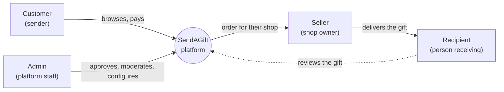

Key ideas used throughout:

| Term | Meaning |
|---|---|
| **Country** | Every account belongs to a country. Admins decide which features are switched on per country (see [Country capabilities](#52-countries-and-capabilities)). |
| **Shop** | A seller can run one or more shops. Each shop has products and **delivery zones** (where and how far it delivers). |
| **Recipient** | A person the customer sends gifts to, saved with their own addresses. |
| **Order / order item** | One checkout is an **order**. Each product line is an **order item** belonging to one seller, so a multi-seller order moves forward line by line. |
| **Points** | A loyalty currency. Customers earn and spend them; sellers buy points to fund rewards. |
| **Free gift** | A one-time program: each customer can send one free gift, paid from a seller's marketing budget. |

---

## 2. The three roles and how access works

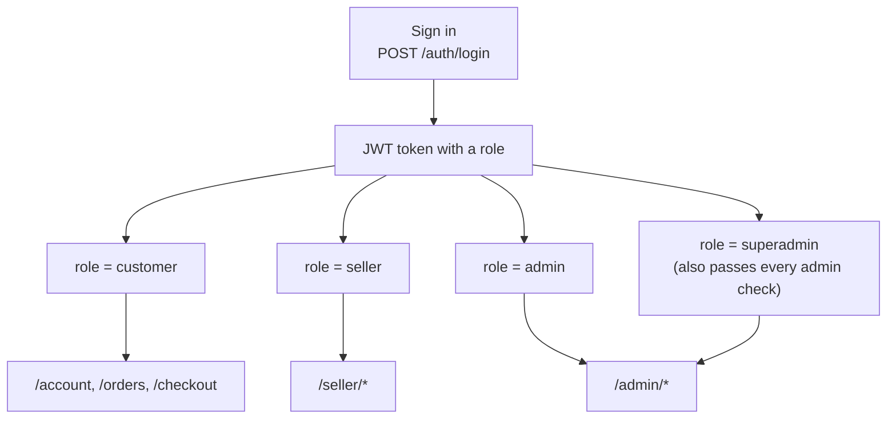

| Role | Signs in at | Home screen | Notes |
|---|---|---|---|
| **Customer** | `/login` | `/products`, then `/orders` | Can also sign in with a one-time code, Google or Facebook. |
| **Seller** | `/seller/login` | `/seller` | Must **confirm their email** before first sign-in. A **suspended** seller is blocked from most seller actions. |
| **Admin** | `/admin/login` | `/admin` | Created by a superadmin. |
| **Superadmin** | `/admin/login` | `/admin` | The first admin, created once via the bootstrap route. Can do everything an admin can, plus the high-risk actions marked 🔒. |

The three login URLs (`/auth/login`, `/customers/login`, `/sellers/login`) all call the same handler. It looks the email up as admin, then customer, then seller, and the `role` in the response decides which routes the token opens.

**Guests** (not signed in) can browse the storefront, search gifts, watch reels, play games and comment/like on reels (using a guest token). They are asked to sign in at checkout.

**Frontend route guards:** `ProtectedRoute` only lets the listed roles in; `GuestRoute` bounces already-signed-in users away from login/register pages.

---

## 3. Customer guide

### 3.1 Register an account

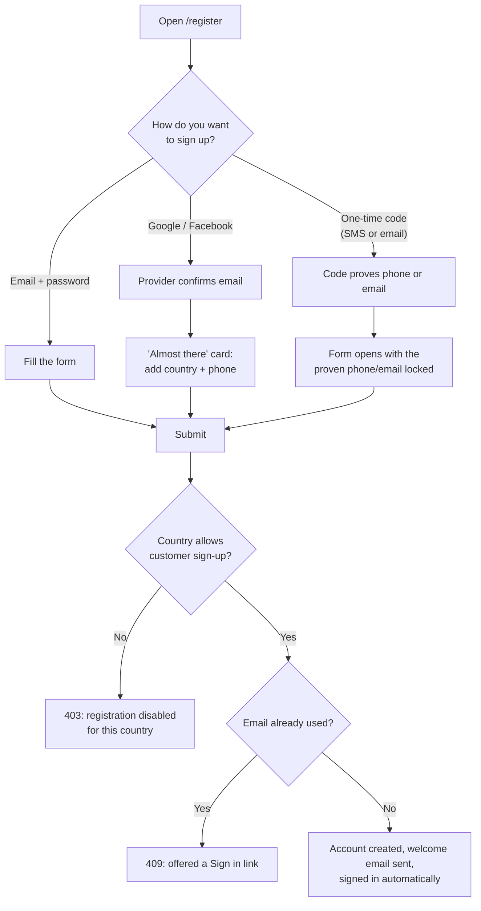

**Steps (email sign-up)**

1. Go to **`/register`** (the old `/customer/register` redirects here).
2. Choose **"I'm gifting as"**: *Just me* (individual), *Family*, or *Business*.
3. Enter **Your name**, **Email**, **Country** (the country you are gifting from) and **Phone number**.
4. Create a **password** (at least 8 characters; a strength meter helps) and **confirm** it.
5. Press submit. The account is created and you are signed in straight away. A welcome email is sent.
6. Later, from your account pages, add a photo and delivery addresses.

**Rules the form and API enforce**

| Field | Rule |
|---|---|
| Name | Required on the form. If left empty through the API it defaults to the part of the email before `@`. |
| Email | Valid format, stored lower-case, must be unique (`409 email already registered`). An address someone just changed away from stays reserved while they can undo the change. |
| Phone | Required (at least 7 digits on the form). |
| Country | Must exist and have `customer_registration_enabled` on, otherwise `403`. |
| Password | At least 8 characters. |
| Customer type | `individual` (default), `family`, `business`. |
| Date of birth | Optional, `YYYY-MM-DD`. |
| Addresses | Optional at sign-up; each needs country, line 1 and city. A single address becomes the default. |

**Sign-up variations**

- **Google / Facebook** (`POST /auth/social`, then `/auth/social/complete`): the provider vouches for the email, so you only add country and phone.
- **One-time code** (`POST /customers/login/code`, `/customers/login/code/verify`): type a phone or email on the login page's *One-time code* tab. If no account exists you are sent to `/register` with that phone/email already proven (a `signup_token` carries the proof, and the phone/email is marked verified).

### 3.2 Sign in, recover access

| Task | Where | API |
|---|---|---|
| Sign in with password | `/login` | `POST /customers/login` |
| Sign in with a 6-digit code | `/login` → *One-time code* tab | `POST /customers/login/code`, `POST /customers/login/code/verify` |
| Sign in with Google/Facebook | `/login` | `POST /auth/social` |
| Forgot password | `/forgot-password` | `POST /customers/forgot-password`, `POST /customers/reset-password` |
| Open a review link from a gift | `/review/:token` → `/login?review=…` | see [Gift reviews](#66-gift-reviews-for-recipients) |

### 3.3 Browse and find gifts

**Public routes (no sign-in):** `/` (home), `/products`, `/products/:productId`, `/sellers/:sellerId`, `/sellers/:sellerId/shops/:shopId`, `/reels`, `/free-gift`, `/become-a-seller`, `/legal`.

**Filters on `/products`**

| Filter | How it works |
|---|---|
| **Search box (`?q=`)** | Matches gift name, description, seller name, shop name and occasion tags. |
| **Occasion (`?category=`)** | Birthday, Flowers, Hampers, Wellness, Tech Gifts, Keepsakes, or *All*. On narrow screens it is a pop-over. |
| **Where + when (delivery search bar)** | Enter a delivery address (Google Places autocomplete) and arrival date. The page then shows **only gifts a shop can deliver to that point on that day**, using each shop's delivery zones. |
| **Paging (`?page=`)** | 8 gifts per page. Changing a filter resets to page 1. |

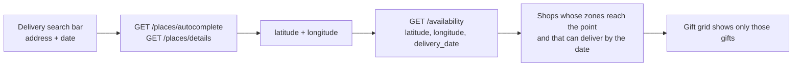

`GET /availability` rules: latitude and longitude are required; `delivery_date` must be `yyyy-mm-dd` and today or later; `customer_type` (`personal` or `corporate`) is optional.

**Other browse features**

- **Product page** shows photos/videos, price, rating summary and reviews, reels about the product, and *Save* / *Add to cart* / *Message seller*.
- **Save a gift** (heart icon): `POST /customers/me/saved-gifts`; list at `/account/saved-gifts`; remove with `DELETE /customers/me/saved-gifts/{id}` (the id is the saved-gift id, not the product id).
- **Cart** (`/cart`) is stored in the browser, so guests can fill it before signing in.
- **Reels** (`/reels`): a vertical video feed. Like and comment as a guest or customer; filter by shop or product.

### 3.4 Create a recipient

Recipients live at **`/account/recipients`**.

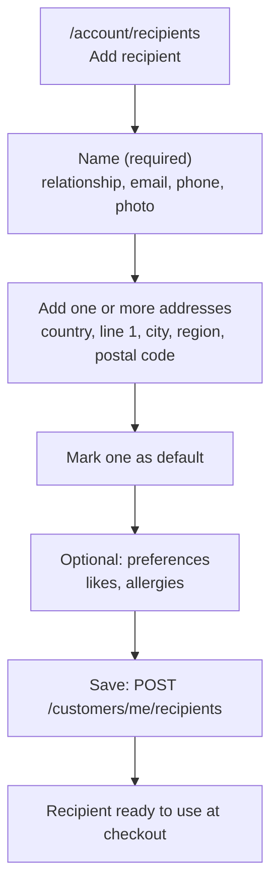

**Steps**

1. Open **Account → Recipients** and choose **Add recipient**.
2. Enter the **name** (required). Optionally add relationship (e.g. sister), **email**, **phone**, and a photo.
3. Add an **address** (country, line 1, city; region and postal code optional; label like *Apartment*). Tick *default* for the one to use first.
4. Optionally save **preferences** (likes, allergies) as notes.
5. Save. You can also add a recipient on the spot during checkout.

**Good to know**

- The recipient's **email and phone** matter: they are how the gift notification and review link reach the person, and the free-gift program **requires both**.
- Addresses can be sent when **creating** the recipient. To change them later use the address routes (add, edit, delete); a `PUT` on the recipient does not replace the address list.
- Deleting the default address clears the recipient's default.
- The default address must belong to that recipient (`400 default_address_id must belong to this recipient`).

| Action | API |
|---|---|
| Create | `POST /customers/me/recipients` |
| List (without addresses) | `GET /customers/me/recipients` |
| One recipient (with addresses) | `GET /customers/me/recipients/{id}` |
| Update details | `PUT /customers/me/recipients/{id}` |
| Delete | `DELETE /customers/me/recipients/{id}` |
| Add address | `POST /customers/me/recipients/{id}/addresses` |
| Edit address | `PUT /customers/me/recipients/{id}/addresses/{addressId}` |
| Delete address | `DELETE /customers/me/recipients/{id}/addresses/{addressId}` |

Your own delivery addresses live at **`/account/addresses`** (`POST /customers/me/addresses`, `DELETE /customers/me/addresses/{id}`).

### 3.5 Send a gift (checkout)

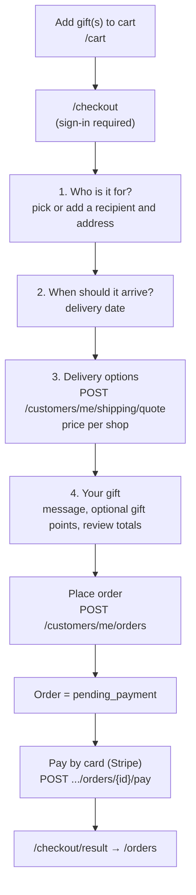

**Steps**

1. **Add gifts to the cart.** Gifts from several sellers can be in one cart.
2. Open **`/checkout`**. If you are not signed in, you are asked to sign in or register first.
3. **Who is it for?** Choose a saved recipient and their delivery address, or add a new recipient inline.
4. **When should it arrive?** Pick the delivery date. It is checked against each shop's delivery rules; a shop that cannot make that date or location is flagged.
5. **Delivery options.** The platform prices delivery per shop from the shop's delivery zones (`/customers/me/shipping/quote`), showing price and estimated days.
6. **Your gift.** Add a **gift message**, optionally attach a **media greeting**, and optionally send **gift points** from your balance (0 to 1,000,000; they reach the recipient on delivery if their email belongs to a SendAGift account, otherwise they return to you).
7. **Place the order.** It is created as `pending_payment`, then you **pay by card**. `POST /customers/me/orders/{id}/payment-sheet` is used by the mobile app and `/payment/sync` confirms the payment.
8. You land on **`/checkout/result`**, then **Track orders**.

The order records which **recipient address** it goes to (`delivery_address_id`); if none was chosen, the recipient's default address is used.

**Order rules**

| Rule | Detail |
|---|---|
| Order type | `personal` (default) or `corporate`. A product can be visible to personal, corporate or both. |
| Delivery date | Required and must be a valid date. |
| Items | All items must share the same currency; products must be published and visible for the customer type. |
| Gift points | Cannot exceed your balance (`not enough points to attach to this gift`). |

### 3.6 After you order

| Screen | Route | What you do |
|---|---|---|
| **Track orders** | `/orders` | Live progress of active orders (awaiting payment, paid, accepted, preparing, dispatched). |
| **Order detail** | `/orders/:orderId` | Timeline, per-seller item progress, tracking details, **Pay now** for unpaid orders, **Cancel**. |
| **Order history** | `/orders/history` | Delivered, cancelled and refunded orders. |
| **Gifts received** | `/account/gifts` | Gifts other people sent you. Review them here. |
| **Saved gifts** | `/account/saved-gifts` | Your wishlist. |
| **My reviews** | `/account/reviews` | Reviews you wrote; edit or delete them. |
| **Points** | `/account/points` | Balance and ledger; play games to earn more. |
| **Addresses** | `/account/addresses` | Your own addresses. |
| **Recipients** | `/account/recipients` | See [3.4](#34-create-a-recipient). |
| **Profile** | `/account/profile` | Edit details, change password, change email, verify phone, delete account. |

**Cancel an order:** allowed while the order is `draft`, `pending_payment`, `paid`, `confirmed`, `accepted` or `preparing` (not once dispatched). Reward points already spent make an order non-cancellable here (contact support).

**Review a delivered gift:** open the order or *Gifts received*, rate 1 to 5 stars, write text, add up to 9 photos/videos. One review per order item. Other customers can vote reviews helpful; the seller can reply.

**Profile and security**

- Change password: `PUT /customers/me/password`, or a code-based reset via `/customers/me/password/code` and `/password/reset`.
- Change email: `POST /customers/me/email/change` then `/email/confirm`. The old address gets a "this wasn't me" link (`/account/email/undo`) to reverse it.
- Verify phone: `POST /customers/me/phone/code` then `/phone/verify`.
- Delete account: `DELETE /customers/me`. Personal data is anonymised and removed. Blocked while a gift is on its way (`you have a gift on its way…`).

### 3.7 Free gift program

Each customer may send **one free gift, once**, paid from the seller's marketing budget (only when the program is switched on).

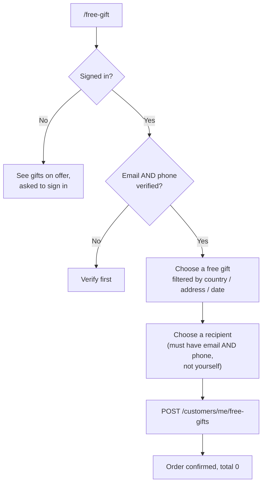

Rules: one per customer for life; one per recipient ever; no self-gift; the customer pays 0 and earns no points. Filters on `GET /free-gifts/products`: `country`, `latitude`, `longitude`, `delivery_date`. Status: `GET /customers/me/free-gift`.

### 3.8 Games, points and competitions

- **Games** (`GET /games`, `/games/{slug}`): skill games (2048, snake, memory, quiz and more). Start a session (`POST /games/{slug}/sessions`), play, submit a score (`POST /games/sessions/{sessionID}/submit`). The server scores the result, so cheating on the client does not work. Leaderboards at `/games/{slug}/leaderboard`.
- **Competitions** (`GET /competitions`): time-limited contests with a live leaderboard (`/leaderboard`, `/events`). Play (`POST /competitions/{id}/plays`), start an official attempt, and, if you win, **claim your prize** (`POST /competitions/{id}/claim`).
- **Points wallet:** `GET /customers/me/points`; earning rule per country: `GET /customers/me/points/earning`.

### 3.9 Chat with sellers and notifications

- **Message a seller** from a product or shop page (`POST /conversations`); the thread appears in your inbox. Send text and up to 5 attachments (15 MB each). You can close/reopen a thread.
- **Notifications:** the app registers its device (`POST /customers/me/push-devices`); the inbox (`GET /customers/me/notifications`) can be marked read or dismissed.

---

## 4. Seller guide

### 4.1 Register as a seller

Sellers use a **multi-step wizard** at **`/seller/register`**, then confirm their email.

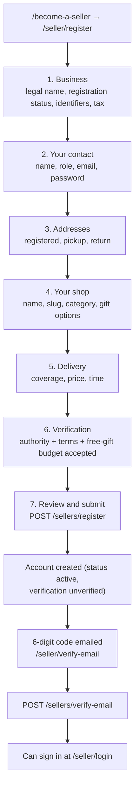

**Steps**

1. Click **Become a seller** (`/become-a-seller`) and start registration.
2. **Business:** legal name, optional trading and local name, seller type (default `individual`), country. State your **registration status**: `registered`, `pending` or `no_number`. If registered, add at least one **business identifier** (type + value). If pending/none, add a note of at least 10 characters. State your **tax status** (`registered`, `not_registered`, `unsure`); if registered, add tax registrations (country, scheme, number).
3. **Your contact:** name, role (`owner`, `director` or `authorised`), job title, email, password (at least 8 characters).
4. **Addresses:** at most one *registered* business address, plus pickup and return addresses.
5. **Your shop:** shop name and URL slug (check availability live with `GET /sellers/shops/slug-available?slug=`), category (flowers, hampers, food, personalised, home, beauty, jewellery, toys, art, other) and gift options (message, wrapping, personalisation). The shop needs a **pickup address with latitude and longitude** so delivery distance can be measured.
6. **Delivery:** set how far you deliver, what it costs and how long it takes (delivery zones).
7. **Verification:** confirm you are authorised, accept the terms, and accept the **free gift marketing budget** (required to register).
8. **Review and submit.**
9. **Confirm your email:** a 6-digit code is emailed. It lasts **15 minutes**, allows **5 attempts**, and you can request a new one once per **minute** (`/seller/verify-email`; `POST /sellers/verify-email/resend`).
10. Sign in at **`/seller/login`**. Until the email is confirmed, sign-in says *confirm your email before signing in*.

The country must have `seller_registration_enabled` on, otherwise `403`.

**After registering:** admins may mark the seller **verified** (a *Verified seller* badge appears on the storefront). Admins may also **suspend** a seller, which blocks the seller area.

### 4.2 Seller workspace map

All routes sit under `/seller` and need a seller session.

| Menu | Route | What it is for |
|---|---|---|
| Dashboard | `/seller` | Summary, shortcuts, shop list |
| Shops | `/seller/shops` | Create and edit shops, delivery zones |
| Products | `/seller/products` | Create and edit gifts |
| Inventory | `/seller/inventory` | Stock levels and unavailable dates |
| Reels | `/seller/reels` | Short videos about shops/products |
| Orders | `/seller/orders` (and `/seller/orders/:orderItemId`) | Accept and deliver orders |
| Reviews | `/seller/reviews` | Read and reply to reviews |
| Earnings | `/seller/earnings` | What you have earned |
| Payouts | `/seller/payouts` | Stripe payout account, withdrawals |
| Points | `/seller/points` | Buy points |
| Free gifts | `/seller/free-gifts` | Free gift program and budget |
| Analytics | `/seller/analytics` | Performance charts |
| Inbox | `/seller/inbox` | Customer chat (shows unread count) |
| Profile | `/seller/profile` | Business details, addresses, password, email |

### 4.3 Shops and delivery zones

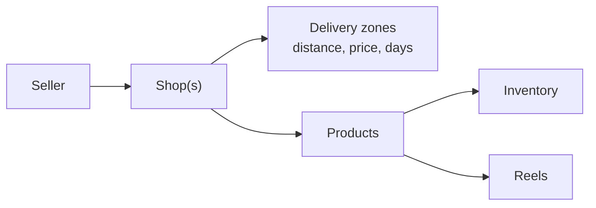

| Action | API |
|---|---|
| List / create shop | `GET` / `POST /sellers/me/shops` |
| Edit / delete shop | `PUT` / `DELETE /sellers/me/shops/{id}` |
| Read / replace delivery zones | `GET` / `PUT /sellers/me/shops/{shopID}/delivery-zones` |
| Manage addresses | `POST /sellers/me/addresses`, `PUT` / `DELETE /sellers/me/addresses/{id}` |

Delivery zones decide **which customers can order from you** (the `GET /availability` search uses them) and what delivery costs at checkout.

### 4.4 Create a product

The product wizard (`/seller/products`) has six steps:

1. **The gift:** name, description, occasion category/tags, product type, who it is visible to (personal, corporate or both), preparation time.
2. **Price:** price (minor currency units), currency, optional reward points per unit, whether to show points.
3. **Media:** up to 12 photos/videos, uploaded straight to cloud storage via presigned URLs (`POST /media/presign-upload`). The first image becomes the cover.
4. **Stock:** available quantity, low-stock threshold, **unavailable dates** (days you cannot deliver).
5. **Parcel:** length, width, height and weight.
6. **Preview**, then save as **draft** or **publish**.

**Product status:** `draft`, `published`, `paused`, `rejected`. Only published products in an active shop appear to customers.

| Action | API |
|---|---|
| List products of a shop | `GET /sellers/me/shops/{shopID}/products` |
| Create | `POST /sellers/me/shops/{shopID}/products` |
| Read / update / delete | `GET` / `PUT` / `DELETE /sellers/me/products/{id}` |
| Stock | `GET` / `PUT /sellers/me/products/{id}/inventory` |

**Inventory filters** (`/seller/inventory`): search by product or shop name, plus **All**, **Needs attention** (out of stock, low or unset), **Free gift** (products in the free gift program).

### 4.5 Receive and fulfil orders

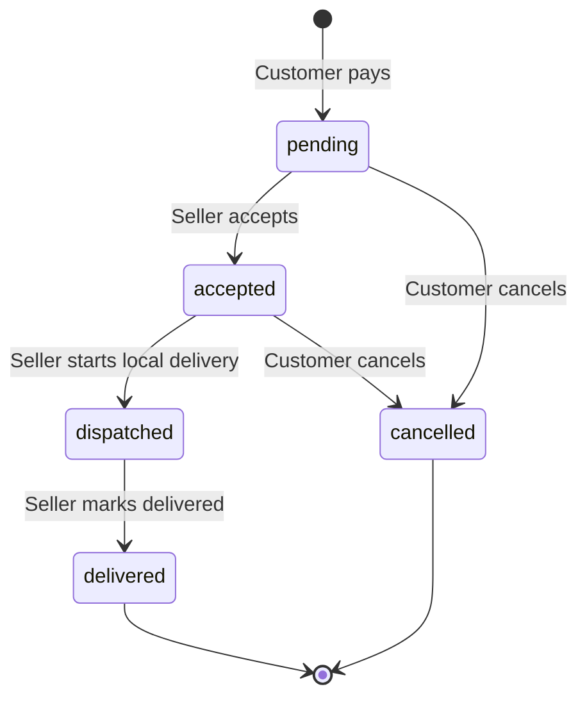

**Steps**

1. Open **Orders**. Each row is one order item for one of your shops: product, recipient, delivery date, status. Click a row to open the **detail panel** (order, product, recipient, ship-to address, what the customer paid for delivery).
2. **Accept** a `pending` item (`PATCH /sellers/me/order-items/{id}/accept`).
3. Prepare the gift.
4. **Start delivery** (`POST /sellers/me/orders/{orderID}/shops/{shopID}/shipping/local`) and enter your courier or tracking details. The item becomes `dispatched` and the customer can see tracking.
5. When it arrives, **mark delivered** (`.../shipping/local/delivered`).
6. When all items of an order are delivered or cancelled, the order becomes `delivered`; the buyer and recipient are notified and reviews open.

A multi-seller order moves line by line. Each seller only ever sees their own lines.

### 4.6 Reviews, reels and chat

- **Reviews** (`/seller/reviews`): see every review of your products. Reviews you have not answered are counted. **Reply** (`PUT /sellers/me/reviews/{id}/reply`) or remove your reply.
- **Reels** (`/seller/reels`): a 5-step wizard: *The clip*, *Caption*, *Tagged gift*, *Publishing*, *Preview*. Reels can be created for a shop or for a product, edited and deleted.
- **Inbox** (`/seller/inbox`): reply to customers' product and order questions; mark read, close or reopen threads.

### 4.7 Money: earnings, payouts, points, free gifts

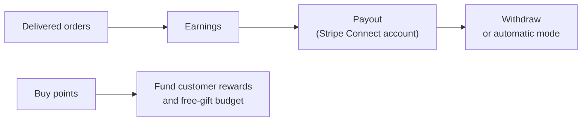

- **Payouts:** connect a Stripe account (`POST /sellers/me/stripe/onboarding`), check status (`GET /sellers/me/stripe`), choose payout mode (`PUT /sellers/me/payouts/mode`), withdraw (`POST /sellers/me/payouts/withdraw`), see history (`GET /sellers/me/payouts`).
- **Points:** buy packages (`GET /sellers/me/points/packages`, `POST /sellers/me/points/purchases`), pay, then sync. Points reward customers who buy your products. A low-points alert is shown in the app.
- **Free gift program** (`/seller/free-gifts`): view or set your program and budget (`/sellers/me/free-gift-program`), choose which products customers may send for free (`PUT /sellers/me/free-gift-products/{productID}`). The item and its delivery are paid from your budget.

### 4.8 Seller account security

Change email (code confirmation plus undo link at `/seller/email/undo`), change password via emailed code, forgot password at `/seller/forgot-password`, and close the account (`DELETE /sellers/me`).

---

## 5. Admin guide

Admins work in **`/admin`** (a side menu with groups). Both `admin` and `superadmin` can sign in.

### 5.1 Getting an admin account

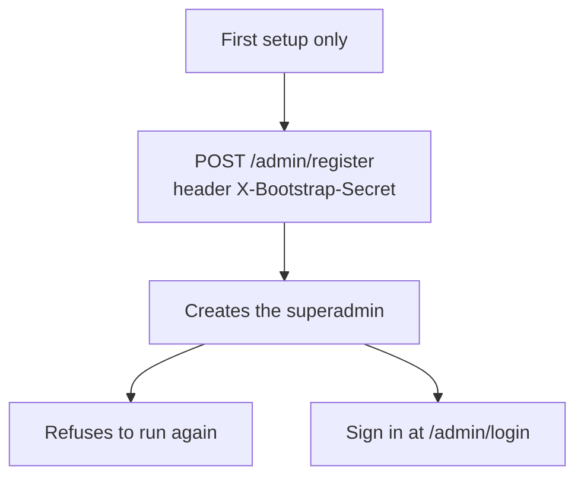

Further admins are added by a superadmin (the **Admin team** screen, `/admin/admins`, is currently a *coming soon* placeholder). Admin profile: `/admin/account` (`GET` / `PUT /admin/me`, name and photo).

### 5.2 Admin workspace map

| Group | Screen | Route | Who |
|---|---|---|---|
| Overview | Dashboard | `/admin` | admin, superadmin |
| Support | Inbox | `/admin/inbox` | admin, superadmin |
| Marketplace | Sellers | `/admin/sellers`, `/admin/sellers/:sellerId` | admin, superadmin |
| Marketplace | Customers | `/admin/customers`, `/admin/customers/:customerId` | admin, superadmin |
| Marketplace | Seller points | `/admin/points` | admin, superadmin (🔒 confirm/fail: superadmin) |
| Marketplace | Point packages | `/admin/points/packages` | view: admin; 🔒 create/edit: superadmin |
| Marketplace | Free gifts | `/admin/free-gifts` | admin, superadmin |
| Games | Games & scores | `/admin/games`, `/admin/games/:slug` | admin, superadmin |
| Games | Competitions | `/admin/competitions`, `/admin/competitions/:id` | admin; 🔒 lifecycle: superadmin |
| Configuration | Countries | `/admin/countries`, `/admin/countries/:countryId` | admin, superadmin |
| Configuration | Admin team | `/admin/admins` | placeholder |
| Account | Profile | `/admin/account` | admin, superadmin |

**🔒 High-risk actions** need a **password re-confirmation** (valid for 5 minutes): the app shows a dialog and calls `POST /admin/reauth`, then sends the token in the `X-Reauth-Token` header.

### 5.3 Dashboard

Shows recent sellers and customers, countries that are active, running and live competitions, top games by plays, and counts needing attention.

### 5.4 Sellers

**Filters:** tabs **Active · Suspended · All**; search box (name or email); paged (10 per page). API: `GET /admin/sellers?status=&q=&limit=&offset=` returning `{ items, total }`.

| Action | What it does | API |
|---|---|---|
| Open a seller | Full profile: business, identifiers, tax, addresses, shops | `GET /admin/sellers/{id}` |
| **Suspend / reactivate** | A suspended seller cannot sign in or use seller tools | `PATCH /admin/sellers/{id}/status` |
| **Verify** | Sets the verification status; shows the *Verified seller* badge to customers | `PATCH /admin/sellers/{id}/verification` |

### 5.5 Customers

Search by **email or name** (`GET /admin/customers?q=`). Open a customer (`GET /admin/customers/{id}`) to see profile, orders and points. Admins can **adjust a customer's points** with a reason (e.g. goodwill credit): `POST /admin/customers/{customerID}/points/adjustments` 🔒. Wallet: `GET /admin/customers/{customerID}/points`.

### 5.6 Countries and capabilities

Countries are the platform's reference data (ISO code, name, currency, timezone) with a **status**: `full`, `marketplace`, `customer_only`, `browse_only`, `blocked`.

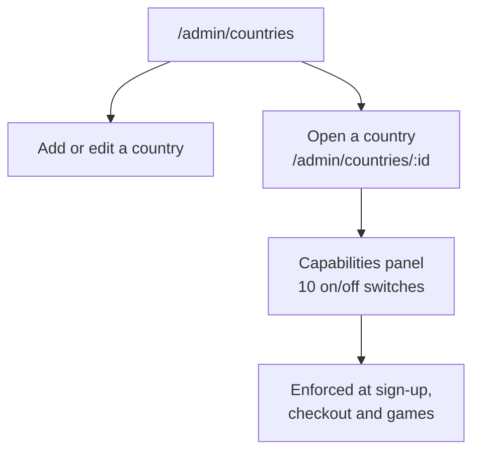

The 10 capability switches: customer registration, seller registration, seller payouts, domestic delivery, international delivery, memberships, points earning, points usage, skill competitions, app store availability. Turning off *customer registration* makes sign-up return `403 customer registration is disabled for this country`; the same applies to sellers.

API: `POST` / `PUT` / `DELETE /admin/countries[/{id}]`; `GET /admin/country-capabilities`; `GET` / `POST` / `PUT` / `DELETE /admin/countries/{id}/capabilities`. `iso_code` must be two letters and unique (`409` otherwise).

### 5.7 Seller points and point packages

- **Seller points** (`/admin/points`): see every seller points purchase. **Tabs:** Pending · Completed · Failed · Cancelled · All, with summary cards. Superadmin can **confirm** or **fail** a purchase 🔒 (`POST /admin/points/purchases/{id}/confirm|fail`).
- **Point packages** (`/admin/points/packages`): the bundles sellers can buy. Superadmin creates and edits them 🔒.
- **Earning rules** (per country, how customers earn points): `GET /admin/points/earning-rules`; superadmin sets `PUT /admin/points/earning-rules/{countryID}` 🔒 and can run an earning job (`POST /admin/points/earning-runs`).

### 5.8 Free gifts

`/admin/free-gifts`: overview of each seller's program (active vs stopped), the orders sent, and **country budgets**. Admins can **stop or resume** one seller's program, set a program for a seller, and set the budget per country (`/admin/free-gifts/...`). The whole program is off unless `FREE_GIFT_ENABLED` is set on the server.

### 5.9 Games and competitions

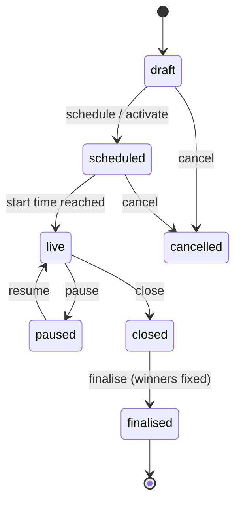

- **Games & scores:** list games, view leaderboards and scores per game, **review a suspicious score**, and set the **play cost** in points 🔒.
- **Competitions** (`/admin/competitions`): **filter tabs** All · Draft · Scheduled · Live · Paused · Closed · Finalised · Cancelled.
  - Admin: create, edit, duplicate, view ledger, plays, analytics, leaderboard, review queue and winners; review submissions; freeze.
  - Superadmin: set and fund the **prize reserve**, schedule/activate, pause/resume, close, **finalise**, validate or disqualify winners, mark unclaimed, and advance prize claims (verified → fulfilled).
  - 🔒 Re-auth required for: cancel, prize adjustments, void a play, settle, run the draw.

### 5.10 Support inbox

`/admin/inbox` is the same chat system as customers and sellers. Admins can open conversations, reply, close and reopen. Unread count shows in the menu.

---

## 6. Shared features

### 6.1 Chat (messaging)

One system for all three roles. A thread is created with `POST /conversations` (reused if it already exists). Participants only: anyone else gets `404`. Routes: list, get, `messages` (list and send), `read`, `close`, `reopen`. A suspended seller is blocked.

### 6.2 Reels

Public: `GET /reels`, `/reels/{id}`, `/shops/{shopId}/reels`, `/products/{productId}/reels`. Feed filters: `shop_id`, `product_id`, `scope`, `cursor`, `limit`. Likes and comments (up to 1,000 characters) work for customers and guests (`X-Guest-Token`).

### 6.3 Reviews

Public: summary and list per product, list per shop, one review. Customers create (delivered items only, one per item), edit, delete and vote helpful; sellers reply. Lists use `cursor` and `limit` paging.

### 6.4 Maps and addresses

`GET /places/autocomplete?input=` and `GET /places/details` proxy Google Places (rate limited, 120 per minute per address).

### 6.5 Uploads

Photos and videos upload directly to cloud storage: the app asks for a presigned URL (`POST /media/presign-upload`), uploads, then reads back with `GET /media/url`.

### 6.6 Gift reviews for recipients

When an order is delivered, the **buyer** is emailed and the **recipient** is emailed and texted a review link.

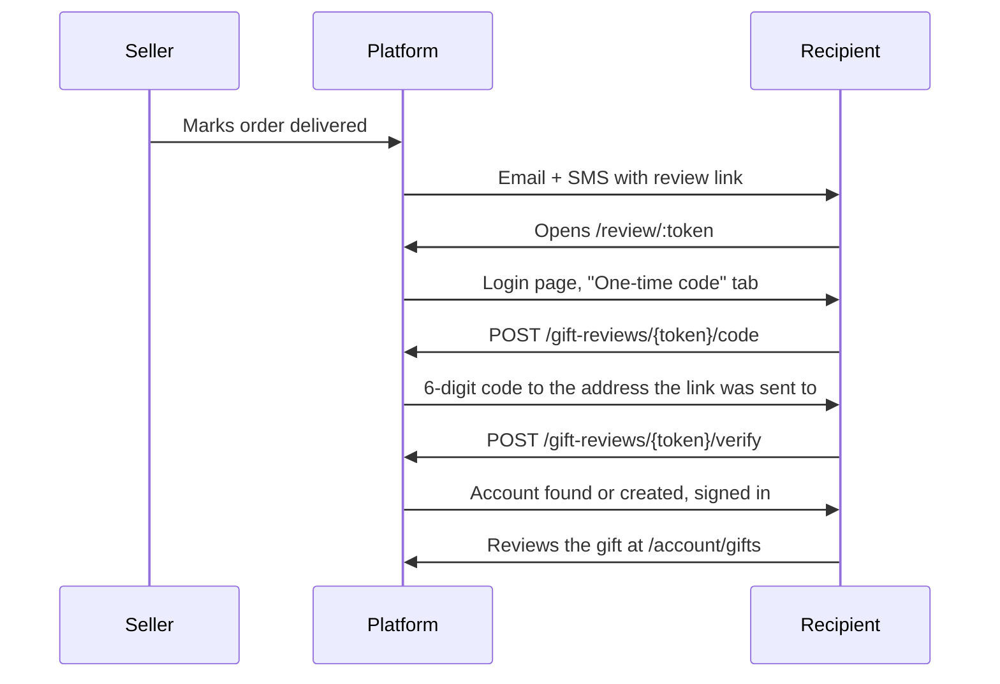

### 6.7 Legal pages

`/legal` lists policies; `/legal/:slug` shows one (privacy, customer terms, and others).

---

## 7. Order lifecycle (end to end)

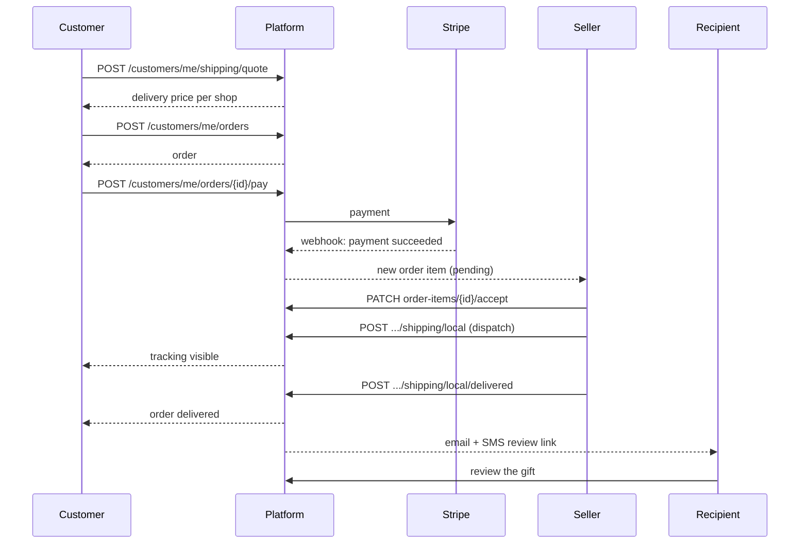

**Multi-seller completion**

| Step | Item A | Item B | Order status |
|---|---|---|---|
| placed | pending | pending | pending_payment |
| both accept | accepted | accepted | unchanged |
| A dispatches | dispatched | accepted | unchanged |
| A delivered | delivered | accepted | unchanged |
| B delivered | delivered | delivered | **delivered** |

The order only becomes `delivered` when every item is delivered or cancelled.

---

## 8. Statuses cheat sheet

| Thing | Values |
|---|---|
| **Order** | `draft`, `pending_payment`, `paid`, `confirmed` (free gift), `accepted`, `preparing`, `dispatched`, `delivered`, `cancelled`, `refunded` |
| **Order item (fulfilment)** | `pending`, `accepted`, `preparing`, `ready`, `dispatched`, `delivered`, `cancelled` |
| **Shipment** | `label_created`, `collected`, `in_transit`, `delivered`, `failed`, `returned` |
| **Order kind** | `paid`, `free_gift` |
| **Gift points on an order** | `none`, `held`, `delivered`, `returned`, `reversed` |
| **Reward points on an item** | `none`, `reserved`, `awarded`, `released`, `reversed` |
| **Seller account** | `active`, `suspended`, `deleted` |
| **Seller verification** | starts `unverified`; set by an admin |
| **Customer type (sign-up)** | `individual`, `family`, `business` |
| **Order type (checkout)** | `personal`, `corporate` |
| **Product** | `draft`, `published`, `paused`, `rejected` |
| **Country** | `full`, `marketplace`, `customer_only`, `browse_only`, `blocked` |
| **Points purchase** | `pending`, `completed`, `failed`, `cancelled` |
| **Competition** | `draft`, `scheduled`, `live`, `paused`, `closed`, `finalised`, `cancelled` |
| **Prize claim** | `pending`, `claimed`, `verified`, `fulfilled`, `expired`, `rejected` |

---

## 9. Rate limits and security rules

| Area | Limit |
|---|---|
| Social sign-in | 20 per minute per address |
| Forgot / reset password, seller email code, undo links | 20 per minute per address |
| Email change request | 5 per minute; confirm 10 per minute |
| One-time code sign-in and phone verify | 10 per minute per address |
| Gift review code | 10 per minute per address |
| Admin re-auth | 10 per minute per address |
| Card payments | 20 per minute per user |
| Seller Stripe onboarding and withdraw | 10 per minute per user |
| Seller points purchases | 30 per minute per user |
| Free gift list / send | 60 per minute per address / 10 per minute per user |
| Competition plays | 20 per minute per user and device, 120 per minute per address |
| Places lookup | 120 per minute per address |

Other rules: passwords are hashed; tokens are JWTs; a sign-in failure never says whether the email or the password was wrong; sensitive links ("this wasn't me") are `POST` so mail scanners cannot trigger them; people can only ever read their own orders, threads and records (others return `404`).

---

## 10. Full API route index

All paths are prefixed with `/api/v1`. 🌐 public · 👤 customer · 🏪 seller · 🛡️ admin · 👑 superadmin · 🔒 needs password re-confirmation.

### Public and auth

| Method | Path | Who | Purpose |
|---|---|---|---|
| GET | `/health`, `/version` (no prefix) | 🌐 | Health check, build SHA |
| POST | `/admin/register` | 🌐 secret | Create first superadmin |
| POST | `/auth/login`, `/customers/login`, `/sellers/login` | 🌐 | Sign in |
| POST | `/auth/social`, `/auth/social/complete` | 🌐 | Google / Facebook |
| POST | `/customers/login/code`, `/customers/login/code/verify` | 🌐 | One-time code sign-in |
| GET/POST | `/gift-reviews/{token}`, `/code`, `/verify` | 🌐 | Recipient review link |
| GET | `/countries`, `/countries/{id}` | 🌐 | Countries |
| GET | `/shops`, `/shops/{shopId}`, `/shops/{shopId}/products`, `/products/{productId}` | 🌐 | Storefront |
| GET | `/availability` | 🌐 | Gifts deliverable to a point and date |
| GET | `/places/autocomplete`, `/places/details` | 🌐 | Address lookup |
| GET | `/reels`, `/reels/{id}`, `/shops/{id}/reels`, `/products/{id}/reels` | 🌐 | Reels feed |
| GET | `/reels/{id}/likes`, `/reels/{id}/comments` | 🌐 | Reel social |
| POST/DELETE/PUT | `/reels/{id}/likes`, `/reels/{id}/comments[/{commentId}]` | 🌐 guest or 👤 | Like and comment |
| GET | `/products/{id}/reviews`, `/reviews/summary`, `/shops/{id}/reviews`, `/reviews/{id}` | 🌐 | Reviews |
| GET | `/games`, `/games/{slug}`, `/games/{slug}/leaderboard` | 🌐 | Games |
| POST | `/games/{slug}/sessions`, `/games/sessions/{id}/submit` | 🌐 guest or 👤 | Play a game |
| GET | `/competitions`, `/{id}`, `/{id}/leaderboard`, `/{id}/events` | 🌐 | Competitions |
| GET | `/free-gifts/products` | 🌐 | Free gifts on offer |
| POST | `/payments/stripe/webhook`, `/payments/stripe/connect-webhook`, `/payments/points/webhook` | Stripe | Payment events |

### Customer 👤

| Group | Routes |
|---|---|
| Account | `GET/PUT/DELETE /customers/me`, `PUT /customers/me/password`, `POST /customers/me/password/code`, `/password/reset`, `POST /customers/me/email/change`, `/email/confirm`, `POST /customers/me/phone/code`, `/phone/verify` |
| Registration helpers (public) | `POST /customers/register`, `/customers/forgot-password`, `/customers/reset-password`, `/customers/email/undo` |
| Addresses | `POST /customers/me/addresses`, `DELETE /customers/me/addresses/{id}` |
| Saved gifts | `GET/POST /customers/me/saved-gifts`, `DELETE /customers/me/saved-gifts/{id}` |
| Recipients | `GET/POST /customers/me/recipients`, `GET/PUT/DELETE /{id}`, `POST /{id}/addresses`, `PUT/DELETE /{id}/addresses/{addressId}` |
| Orders | `POST /customers/me/shipping/quote`, `POST/GET /customers/me/orders`, `GET /{id}`, `POST /{id}/cancel`, `GET /customers/me/received-gifts` |
| Payment | `POST /customers/me/orders/{id}/pay`, `/payment-sheet`, `/payment/sync` |
| Reviews | `POST /customers/me/order-items/{orderItemId}/reviews`, `GET /customers/me/reviews[/{id}]`, `PUT/DELETE /customers/me/reviews/{id}`, `PUT/DELETE /reviews/{id}/vote` |
| Points | `GET /customers/me/points`, `/points/earning` |
| Free gift | `GET /customers/me/free-gift`, `POST /customers/me/free-gifts` |
| Competitions | `POST /competitions/{id}/plays`, `/attempts`, `/claim` |
| Notifications | `POST/DELETE /customers/me/push-devices`, `GET/DELETE /customers/me/notifications`, `POST /customers/me/notifications/read` |
| Chat | `/conversations…` (shared) |

### Seller 🏪

| Group | Routes |
|---|---|
| Sign-up (public) | `POST /sellers/register`, `GET /sellers/shops/slug-available`, `POST /sellers/verify-email`, `/verify-email/resend`, `/forgot-password`, `/reset-password`, `/email/undo` |
| Profile | `GET/PUT/DELETE /sellers/me`, `POST /sellers/me/password/code`, `/password/reset`, `POST /sellers/me/email/change`, `/email/confirm` |
| Addresses | `POST /sellers/me/addresses`, `PUT/DELETE /sellers/me/addresses/{id}` |
| Shops | `GET/POST /sellers/me/shops`, `PUT/DELETE /sellers/me/shops/{id}`, `GET/PUT /sellers/me/shops/{shopID}/delivery-zones` |
| Products | `GET/POST /sellers/me/shops/{shopID}/products`, `GET/PUT/DELETE /sellers/me/products/{id}`, `GET/PUT /sellers/me/products/{id}/inventory` |
| Orders | `GET /sellers/me/order-items`, `GET /{id}`, `PATCH /{id}/accept`, `POST /sellers/me/orders/{orderID}/shops/{shopID}/shipping/local`, `/local/delivered` |
| Reviews | `GET /sellers/me/reviews[/{id}]`, `PUT/DELETE /sellers/me/reviews/{id}/reply` |
| Reels | `GET/POST /sellers/me/shops/{shopID}/reels`, `GET/POST /sellers/me/products/{productID}/reels`, `GET /sellers/me/reels`, `GET/PUT/DELETE /sellers/me/reels/{id}` |
| Payouts | `GET /sellers/me/stripe`, `POST /sellers/me/stripe/onboarding`, `GET /sellers/me/payouts`, `PUT /sellers/me/payouts/mode`, `POST /sellers/me/payouts/withdraw` |
| Points | `GET /sellers/me/points`, `/points/packages`, `/points/purchases`, `POST /points/purchases`, `/{id}/cancel`, `/{id}/test-payment`, `/{id}/sync` |
| Free gifts | `GET/PUT /sellers/me/free-gift-program`, `GET /sellers/me/free-gift-products`, `PUT/DELETE /sellers/me/free-gift-products/{productID}` |
| Uploads | `POST /media/presign-upload`, `GET /media/url` |
| Chat | `/conversations…` (shared) |

### Admin 🛡️ / superadmin 👑

| Group | Routes |
|---|---|
| Profile | `GET/PUT /admin/me`, `POST /admin/reauth` |
| Sellers | `GET /admin/sellers`, `GET /admin/sellers/{id}`, `PATCH /{id}/status`, `PATCH /{id}/verification` |
| Customers | `GET /admin/customers`, `GET /admin/customers/{id}`, `GET /admin/customers/{customerID}/points`, 🔒 `POST /…/points/adjustments` |
| Countries | `POST/PUT/DELETE /admin/countries[/{id}]`, `GET /admin/country-capabilities`, `GET/POST/PUT/DELETE /admin/countries/{id}/capabilities` |
| Seller points | 🛡️ `GET /admin/points/purchases`, `/admin/points/packages`; 👑🔒 `POST /purchases/{id}/confirm|fail`, `POST/PUT /admin/points/packages` |
| Earning rules | 🛡️ `GET /admin/points/earning-rules`; 👑🔒 `PUT /admin/points/earning-rules/{countryID}`; 👑 `POST /admin/points/earning-runs` |
| Free gifts | `GET /admin/free-gifts`, `/orders`, `/countries`; `PUT /sellers/{id}/program`, `PUT /countries/{id}`, `PATCH /sellers/{id}` |
| Games | 🛡️ `GET /admin/games`, `/{slug}/leaderboard`, `/{slug}/scores`, `POST /scores/{id}/review`; 🔒 `PUT /{slug}/play-cost` |
| Competitions (admin) | `GET/POST /admin/competitions`, `GET/PUT/PATCH /{id}`, `duplicate`, `ledger`, `plays`, `analytics`, `reconcile`, `leaderboard`, `review-queue`, `submissions/{id}/review`, `freeze`, `winners`, `draw` (GET) |
| Competitions (superadmin) | 👑 `prize-reserve`, `prize-reserve/fund`, `schedule`, `activate`, `pause`, `resume`, `close`, `finalise`, winners `validate` / `disqualify` / `unclaimed`, claims `verify` / `fulfil` |
| Competitions (re-auth) | 👑🔒 `cancel`, `prize-adjustments`, `plays/{id}/void`, `settle`, `draw` (POST) |
| Chat | `/conversations…` (shared) |

---

## 11. How-to cookbook ("I want to…")

Short recipes for common jobs. Menu names match the app's side menu or account menu.

### Customers

| I want to… | Do this |
|---|---|
| **Find a gift that can reach my friend** | `/products` → enter their address and the date in the search bar → pick from the filtered grid. If the grid is empty, no shop covers that address on that day: try another date or a nearby address. |
| **Find a gift for a specific occasion** | `/products` → choose an **Occasion** (Birthday, Flowers, Hampers, Wellness, Tech Gifts, Keepsakes). Combine it with the search box. |
| **Search by shop or seller name** | Type the name in the search box. It matches gift names, descriptions, seller names, shop names and tags. |
| **Save a gift for later** | Click the heart on a gift (sign in first). Find it in **Account → Saved gifts**. |
| **Send the same person gifts again** | Save them once under **Account → Recipients**. Next time just pick them at checkout. |
| **Send a gift to someone with several addresses** | Add each address to the recipient and mark one as default. At checkout pick the right one. |
| **Add a personal touch** | At checkout write a **gift message** and, if offered, attach a **media greeting**. |
| **Send points along with a gift** | In the **Your gift** step enter a number of gift points (up to your balance). |
| **Pay for an order I left unpaid** | **Track orders** → open the order → **Pay now**. |
| **Cancel an order** | **Track orders** → open the order → **Cancel**. Works until the seller has dispatched it. |
| **Know where my gift is** | Open the order. The timeline shows placed → paid → accepted → preparing → on the way → delivered, with tracking details once dispatched. |
| **Review a gift I received** | Open the link in the email or text you got, sign in with the one-time code, then rate it on **Gifts received**. |
| **Review a gift I sent** | **Order history** → open the delivered order → review each item. |
| **Message a seller** | On a gift or shop page choose **Message**. Replies appear in your inbox. |
| **Change my email** | **Profile → Change email**, confirm the code. If it was not you, use the "this wasn't me" link from the old address. |
| **Verify my phone** | **Profile → Verify phone**, enter the code you receive. Needed for the free gift. |
| **Reset a forgotten password** | `/forgot-password` → enter your email → follow the code. Or sign in with a **one-time code** instead. |
| **Earn points** | Play games (`/games`) and take part in competitions. Check **Account → Points**. |
| **Use my free gift** | `/free-gift` → verify email and phone → pick a gift and a recipient with email and phone. One time only. |
| **Delete my account** | **Profile → Delete account**. You cannot do this while a gift is still on its way. |

### Sellers

| I want to… | Do this |
|---|---|
| **Open a second shop** | **Shops → Create shop**. Give it its own pickup address and delivery zones. |
| **Control where I deliver** | **Shops** → open the shop → **Delivery zones**. Set distance, price and days for each zone. Saving replaces the whole list. |
| **Hide a gift without deleting it** | **Products** → open it → set status to **paused** (or **draft**). |
| **Stop taking orders on certain days** | **Products → Stock** (or **Inventory**) → add **unavailable dates**. |
| **See what needs restocking** | **Inventory → Needs attention** filter. |
| **Run a promotion video** | **Reels → New reel**: upload the clip, add a caption, tag a gift, publish. |
| **Accept an order** | **Orders** → click the row → **Accept**. |
| **Tell the customer it is on the way** | Open the order → **Start delivery**, enter your courier or tracking details. |
| **Finish an order** | Open the order → **Mark delivered**. |
| **Answer a review** | **Reviews** → open one without a reply → write your reply. Unanswered reviews are counted at the top. |
| **Get paid** | **Payouts** → connect Stripe → choose payout mode → withdraw (or let it run automatically). |
| **Buy points** | **Points** → choose a package → pay → the balance updates after the payment is confirmed. |
| **Join the free gift program** | **Free gifts** → set your program and budget → choose the products customers may send for free. |
| **Chat with a customer** | **Inbox** → open the thread. The menu shows an unread count. |
| **Change my login email** | **Profile → Change email**. A code confirms it; the old address can undo it. |

### Admins

| I want to… | Do this |
|---|---|
| **Switch a country on or off** | **Countries** → open the country → set its status and the capability switches. |
| **Stop customers or sellers signing up in a country** | Turn off *customer registration* or *seller registration* for that country. |
| **Find a seller** | **Sellers** → use the tabs (Active / Suspended / All) and the search box (name or email). |
| **Suspend a seller** | **Sellers** → open the seller → change **status** to suspended. They can no longer use seller tools. Reactivate the same way. |
| **Give a seller the verified badge** | **Sellers** → open the seller → set **verification**. |
| **Find a customer and see their orders** | **Customers** → search by email or name → open. |
| **Credit or remove a customer's points** | **Customers** → open → **Adjust points**, enter an amount and a reason. Needs password re-confirmation. |
| **Approve a seller's points purchase** | **Seller points** → **Pending** tab → confirm or fail (superadmin, re-auth). |
| **Add a points package** | **Point packages** → create (superadmin, re-auth). |
| **Stop one seller's free gift program** | **Free gifts** → open the seller → stop. |
| **Launch a competition** | **Competitions → Create** → choose the game and rules → fund the prize reserve → schedule/activate (superadmin). |
| **Check a suspicious game score** | **Games & scores** → open the game → scores → review the score. |
| **Answer support** | **Inbox** → open the thread → reply → close when done. |

---

## 12. Troubleshooting: what a message means

| What you see | Who | Meaning and fix |
|---|---|---|
| *"Registration is disabled for this country"* (403) | Customer / seller | An admin has switched sign-up off for that country. Pick another country or ask support. |
| *"Email already registered"* (409), or an offer to sign in | Customer / seller | That email has an account. Sign in, or reset the password. An email someone just changed away from stays reserved for a short time. |
| *"Your password needs at least 8 characters"* | All | Use 8+ characters. The strength meter helps. |
| *"Confirm your email before signing in"* | Seller | Open `/seller/verify-email`, type the 6-digit code. Codes last 15 minutes and allow 5 tries. |
| *"That code has expired. Send a new one"* | Seller / customer | Request another. You can ask once per minute. |
| *"Too many tries. Send a new code"* | Seller / customer | Five wrong codes locks that code. Request a new one. |
| *"Wait a minute before asking for another code"* | Seller / customer | A resend cooldown. Try again in a minute. |
| *"Invalid email or password"* | All | The same message is used for both on purpose. Check both, or use **Forgot password**. |
| Seller area shows *suspended* / 403 | Seller | An admin suspended the account. Contact support. |
| *"Delivery date must be today or later"* | Customer | Pick a date from today onward. |
| Gift search shows **0 gifts** | Customer | No shop's delivery zone covers that address on that day. Change the date or address, or clear the address to browse everything. |
| *"Product not available"* / *"not visible for this customer type"* | Customer | The gift is unpublished, paused or hidden from your account type (personal vs corporate). |
| *"Items must share the same currency"* | Customer | Check out gifts priced in one currency at a time. |
| *"Not enough points to attach to this gift"* | Customer | Lower the gift points or earn more first. |
| *"Order cannot be cancelled"* | Customer | It has already been dispatched or finished. Contact the seller via chat. |
| *"This order's reward points have already been spent…"* | Customer | Reward points were used, so it cannot be cancelled here. Contact support. |
| *"You have a gift on its way. You can delete your account once it is delivered or cancelled"* | Customer | Wait for delivery or cancel the order, then delete the account. |
| Free gift button blocked | Customer | You need a verified email **and** phone, a recipient with both email and phone who is not you, and you can only use it once. |
| *"Product already saved"* (409) | Customer | It is already in your saved gifts. |
| *"Default address must belong to this recipient"* | Customer | Pick one of that recipient's own addresses. |
| *"Order item cannot be accepted"* | Seller | It is no longer `pending` (already accepted or cancelled). Refresh the list. |
| *"The shop needs a pickup address with latitude and longitude"* | Seller | Add a pickup address picked from the map search so it has coordinates. |
| Slug shows **not available** | Seller | Another shop uses that URL name. Try another. |
| *"Registration note needs at least 10 characters"* | Seller | Required when your registration is *pending* or you have *no number*. |
| *"Send at most one registered business address"* | Seller | Keep one registered address; make the others pickup/return. |
| Admin action asks for your password again | Admin | It is a high-risk action. Confirm the password; it stays valid 5 minutes. |
| *"Insufficient role"* (403) | Admin | The action is superadmin-only. |
| *"Bootstrap already completed"* (403) | Admin | The first superadmin already exists, or the secret header is wrong. |
| *404* on someone else's order or chat | All | You can only see your own records; the app hides others on purpose. |
| *"Too many requests"* (429) | All | You hit a rate limit ([section 9](#9-rate-limits-and-security-rules)). Wait a minute and retry. |

**Still stuck?** Customers and sellers can use the in-app chat to reach support; admins see it in **Inbox**.

---

## 13. FAQ

**Do I need an account to browse?** No. Guests can browse, search, watch and like reels and play games. You need an account to save gifts, check out and review.

**Can I buy from several sellers in one order?** Yes. Each seller handles their own lines, and the order is marked delivered once every line is delivered or cancelled.

**Does the recipient need an account?** No. They get an email and a text. To review the gift they sign in with a one-time code and an account is created if they have none.

**Who pays for delivery?** The customer, per shop, at checkout. The price comes from the shop's delivery zones. Free gifts are paid by the seller's budget.

**How is my payment handled?** By card through Stripe. Sellers are paid out through their own Stripe account.

**What are points for?** Customers earn them from games and purchases and can attach them to gifts; sellers buy them to fund rewards. Admins can adjust balances.

**Can a seller be both a customer?** Accounts are separate. Use a different email for each role.

**Why can't a seller see my other orders?** Sellers only see the order lines for their own shops.

**Can I change a recipient's address after ordering?** Edit the recipient's addresses any time, but an order keeps the address it was placed with. Contact the seller via chat for a change on an open order.

**What does "Verified seller" mean?** An admin reviewed the seller and set their verification status. The badge appears on their shop.

**Is the Free Gift program always on?** No. It only works when the server flag `FREE_GIFT_ENABLED` is on.

**Is this guide always up to date?** It was checked against the code on 2026-10-16. If something looks different in the app, trust the app and `internal/routes/*.go`, and update this file.

---

## 14. Glossary

| Term | Meaning |
|---|---|
| **Admin / superadmin** | Platform staff. Superadmin can also do the high-risk actions (🔒). |
| **Availability search** | The address-and-date search that filters gifts to those a shop can deliver. |
| **Bootstrap** | The one-time creation of the first superadmin. |
| **Capability** | A per-country on/off switch (e.g. customer registration). |
| **Customer type** | `individual`, `family` or `business` at sign-up; `personal` or `corporate` on an order. |
| **Delivery zone** | A distance band around a shop with its own delivery price and time. |
| **Fulfilment status** | Progress of one order item: pending → accepted → … → delivered. |
| **Gift points** | Points a sender attaches to a gift for the recipient. |
| **Guest token** | A temporary id that lets signed-out visitors like, comment and play. |
| **Idempotency key** | A header that makes repeating a request safe. |
| **JWT** | The signed token returned at sign-in that proves who you are and your role. |
| **Order item** | One product line in an order, owned by one seller. |
| **Order number** | Looks like `SAG-20261016-AB12CD34`. |
| **OTP / one-time code** | A 6-digit code sent by SMS or email to sign in or verify. |
| **Re-auth** | Confirming your admin password again before a high-risk action. |
| **Recipient** | A saved person you send gifts to, with their own addresses. |
| **Reel** | A short video posted by a seller about a shop or product. |
| **Reward points** | Points a customer earns per unit bought, paid from the seller's points. |
| **Slug** | The URL-friendly name of a shop or product. |
| **Stripe Connect** | The account a seller links to receive payouts. |
| **Suspended** | A seller state that blocks the seller area. |

---

*Keep this file in sync when routes change: the source of truth is `internal/routes/*.go` (backend) and `src/app/router.tsx` (frontend).*
