# SendAGift: Simple Guide for Everyone

This guide explains how SendAGift works in plain language. You do not need any technical knowledge. Pick the part that matches you:

- **[I want to send a gift (Customer)](#part-1-for-customers-sending-gifts)**
- **[I want to sell gifts (Seller)](#part-2-for-sellers-selling-gifts)**
- **[I manage the platform (Admin)](#part-3-for-admins-running-the-platform)**
- **[I received a gift (Recipient)](#part-4-for-people-who-receive-a-gift)**

> **Screenshots:** pages anyone can open (home, gifts, registration, sign-in and so on) already have real screenshots. Lines marked 📸 are still empty slots: take the screenshot described, save it in `docs/screenshots/` with the file name shown, and the picture appears automatically. They need a signed-in customer, seller or admin.

---

## Contents

1. [What is SendAGift?](#what-is-sendagift)
2. [Part 1: For customers](#part-1-for-customers-sending-gifts)
3. [Part 2: For sellers](#part-2-for-sellers-selling-gifts)
4. [Part 3: For admins](#part-3-for-admins-running-the-platform)
5. [Part 4: For gift recipients](#part-4-for-people-who-receive-a-gift)
6. [What the order statuses mean](#what-the-order-statuses-mean)
7. [Common questions](#common-questions)
8. [If something goes wrong](#if-something-goes-wrong)
9. [Words explained](#words-explained)
10. [Screenshot checklist](#screenshot-checklist)

---

## What is SendAGift?

SendAGift is an online **gift marketplace**. Think of it as a shopping centre where:

- **Customers** choose a gift and pay for it.
- **Sellers** own the shops, prepare the gift and deliver it.
- **Recipients** are the people who receive the gift.
- **Admins** are the platform staff who keep everything running and safe.

```
Customer  ──pays──▶  SendAGift  ──order──▶  Seller  ──delivers──▶  Recipient
                         ▲                                              │
                         └────────────── review of the gift ◀───────────┘
```

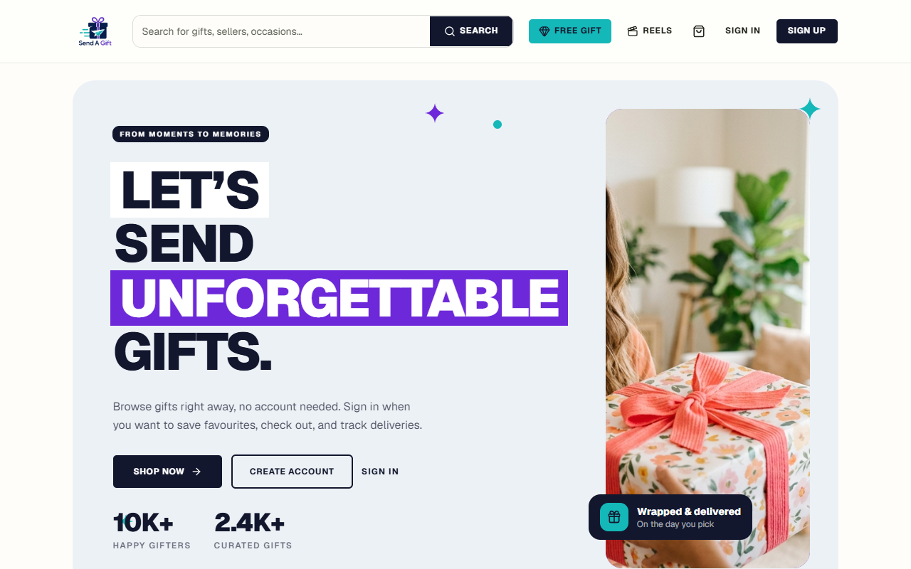

### Who can do what

| | Customer | Seller | Admin |
|---|:---:|:---:|:---:|
| Browse gifts without an account | ✅ | ✅ | ✅ |
| Buy and send gifts | ✅ | | |
| Add products and manage a shop | | ✅ | |
| Receive money from sales | | ✅ | |
| Approve or suspend sellers | | | ✅ |
| Switch countries on or off | | | ✅ |

You sign in on a different page depending on your role:

| Role | Where you sign in |
|---|---|
| Customer | the normal **Sign in** page |
| Seller | the **Seller sign in** page |
| Admin | the **Admin sign in** page |

**Customer sign in**

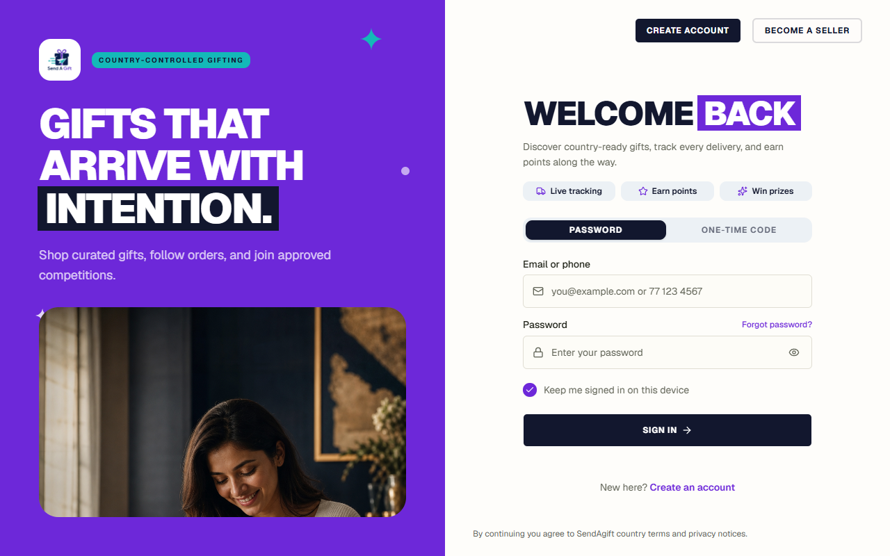

**Seller sign in**

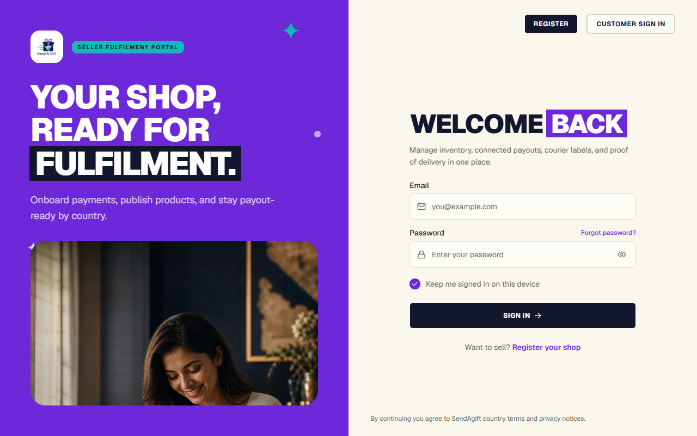

**Admin sign in**

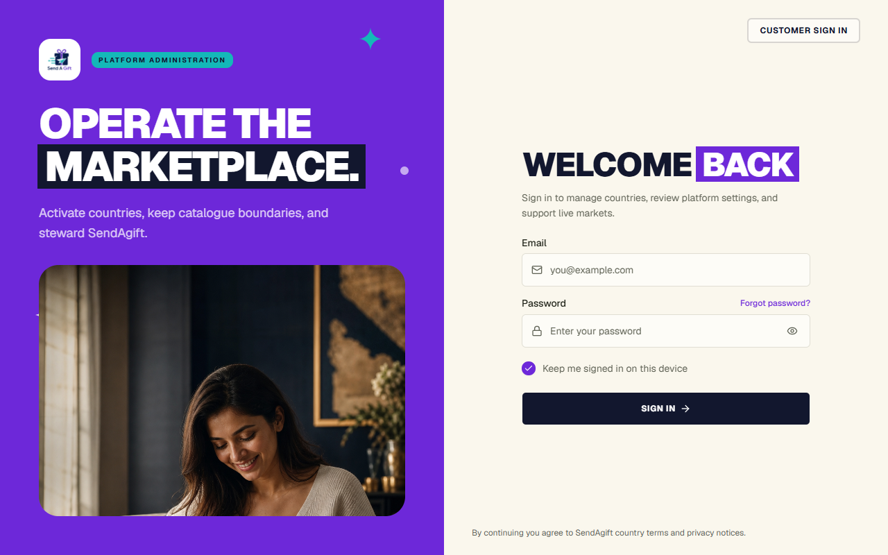

---

# Part 1: For customers (sending gifts)

## 1.1 Look around first (no account needed)

You can browse everything without signing up. An account is needed when you want to **add to cart**, **buy**, **save a gift** or **leave a review**.

1. Open the website and click **Gifts**.
2. Browse the gifts, or use the filters below.

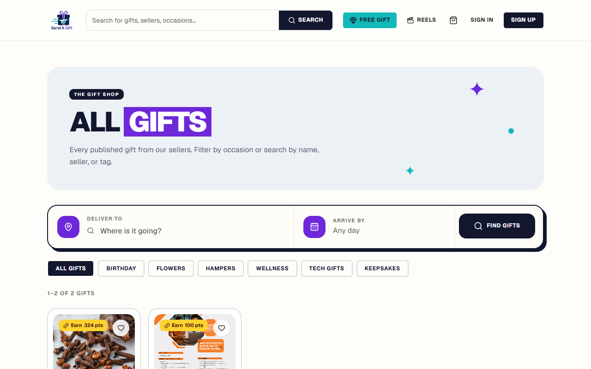

### Ways to find a gift

| Filter | What it does |
|---|---|
| **Search box** | Type a gift name, a shop name, a seller name or an occasion. |
| **Occasion** | Choose Birthday, Flowers, Hampers, Wellness, Tech Gifts or Keepsakes. |
| **Where and when** | Type the address the gift is going to and the date you want it to arrive. The page then shows **only the gifts that can really reach that address on that day**. |

> 💡 **Tip:** use the "where and when" search first. It saves you from falling in love with a gift that cannot be delivered to your friend.

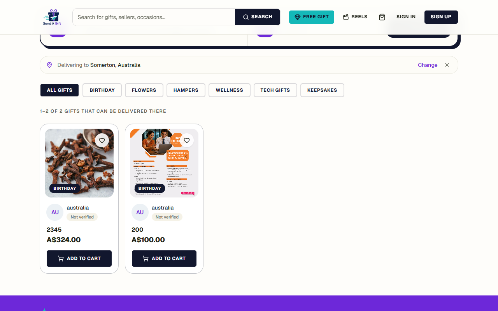

If you see **0 gifts**, no shop delivers to that address on that day. Try another date, or a nearby address.

## 1.2 Look at a gift

Click any gift to open its page. You will see photos, the price, ratings, reviews from other buyers and short videos (called **reels**). From here you can:

- ❤️ **Save** the gift to find it later.
- 🛒 **Add to cart**.
- 💬 **Message the seller** with a question.

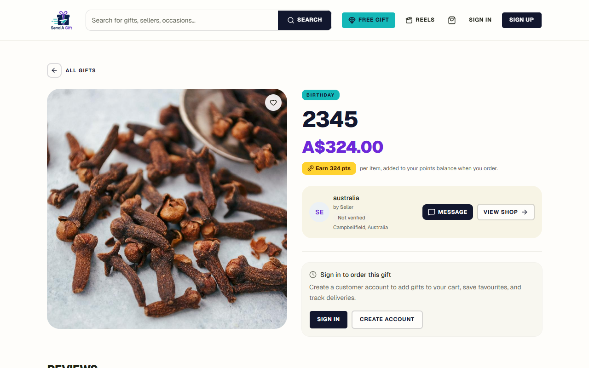

## 1.3 Create your account

1. Click **Register** (or just start checkout and you will be asked).
2. Choose who is gifting: **Just me**, **Family** or **Business**.
3. Fill in your **name**, **email**, **country**, **phone number** and a **password** (at least 8 characters).
4. Press the button to finish. You are signed in straight away and get a welcome email.

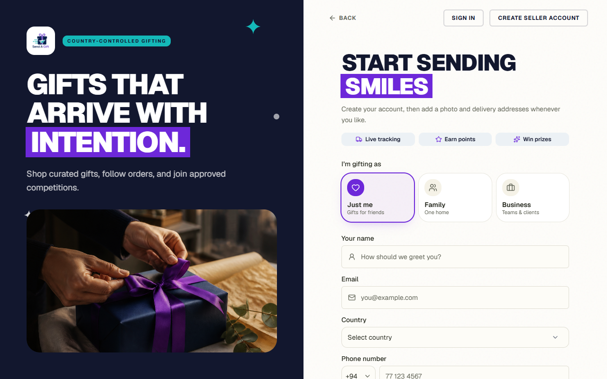

**Other ways to join:** you can also sign up with **Google**, **Facebook**, or with a **6-digit code** sent to your phone or email.


> If you see *"Registration is disabled for this country"*, SendAGift is not open for sign-ups in that country yet.

**Forgot your password?** Click **Forgot password** on the sign-in page and follow the steps, or sign in with a one-time code instead.

## 1.4 Save the people you send gifts to (Recipients)

Save a person once and you never need to type their details again.

1. Go to **My account → Recipients**.
2. Click **Add recipient**.
3. Enter their **name** (required). Add their **email** and **phone** too, because that is how they are told about their gift.
4. Add their **address**. You can add more than one and mark one as the **default**.
5. Save.

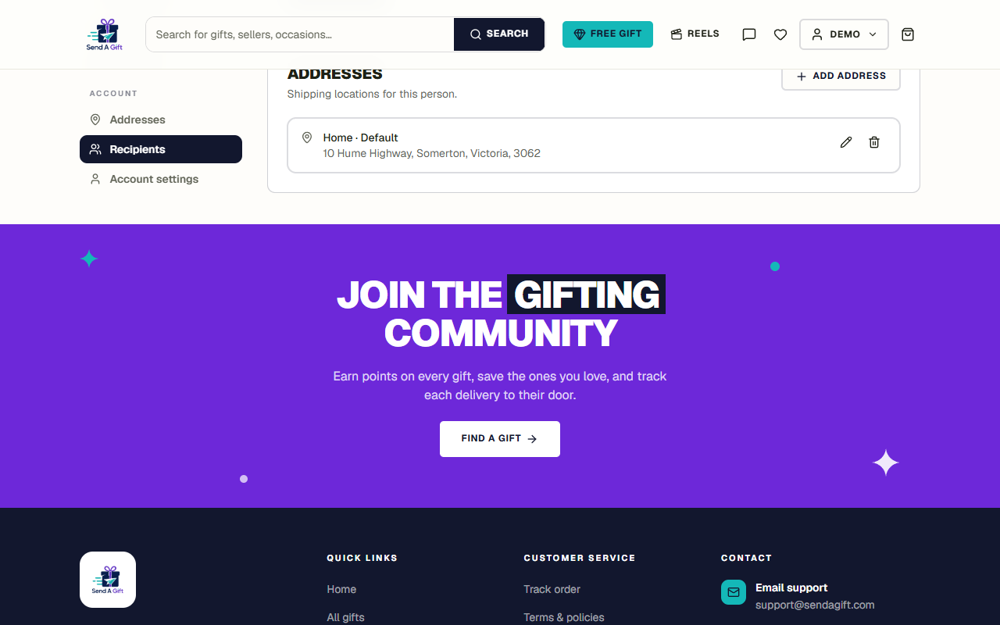

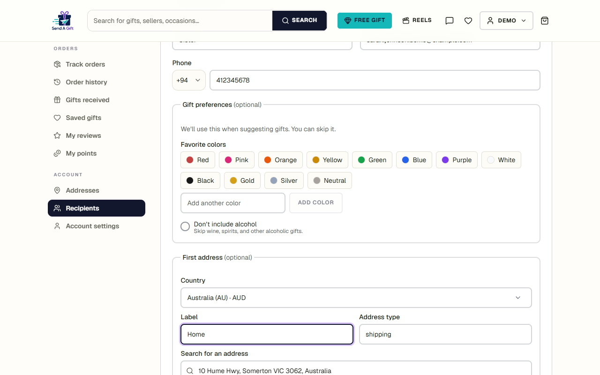

> You can also add a new recipient in the middle of checkout.

## 1.5 Send a gift (checkout)

1. **Sign in, then add gifts to your cart.** The cart asks you to sign in first. You can mix gifts from different sellers in one cart.
2. Open your **cart** and click **Continue to checkout**.
3. **Who is it for?** Pick a saved recipient (their address is shown), or click **Add recipient**.
4. **When should it arrive?** Choose the **delivery country** and the **delivery date** (Tomorrow, In 3 days, Next week, or any date). Leave **Order type** as *Personal* unless you are buying for a business.
5. **Gift message.** Type an optional message for the recipient.
6. **Delivery options.** The page shows the delivery price for each shop, the distance and how many days it takes. The total updates by itself.
7. Check the **Your gift** summary on the right, then click **Send a gift**. You pay securely by card on the next screen.

**Your cart** (with a gift in it):

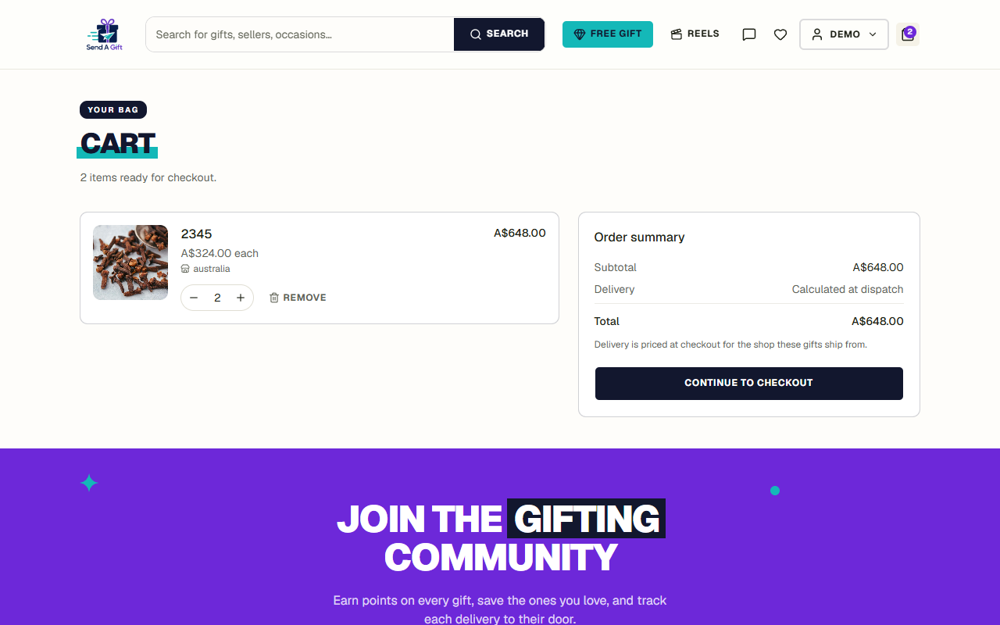

**Checkout: who is it for**

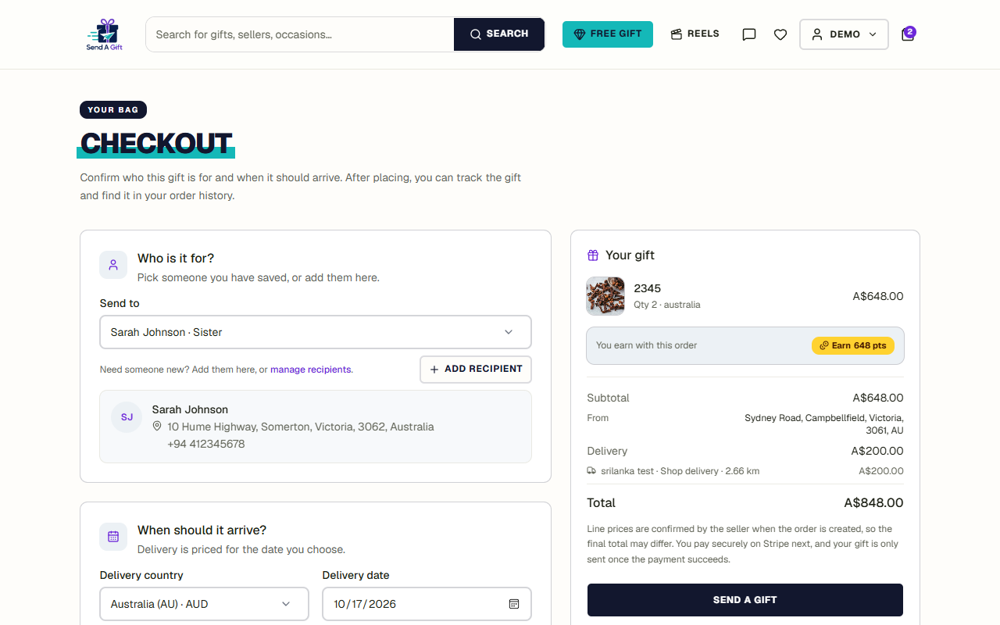

**Checkout: date, message and delivery price**

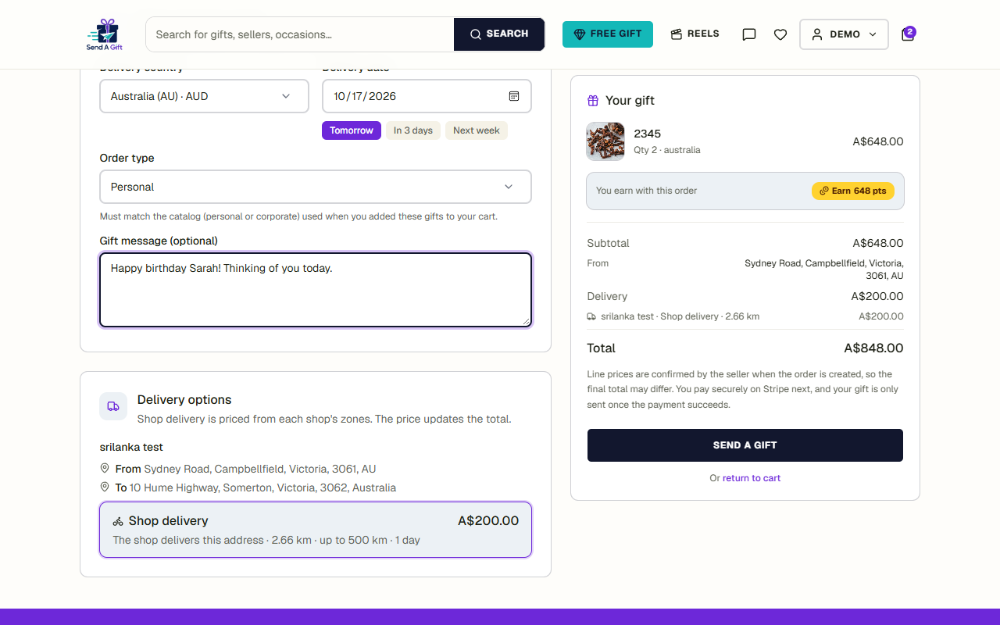

**Checkout: order summary**

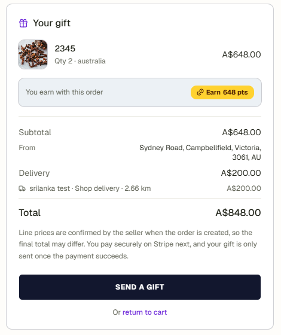


📸 **Screenshot needed:** `14-order-confirmation.png`. The page shown after a successful payment.

**Good to know**

- Everything in one order must use the **same currency**.
- Your payment is handled securely by **Stripe**. SendAGift never sees your full card number.
- The order keeps the address you chose when you placed it.

## 1.6 Follow your order

Go to **Track orders** to see where each gift is.

| Page | What you can do |
|---|---|
| **Track orders** | See active orders and how far along they are. |
| **Order details** | See the full timeline, tracking details, **Pay now** (if unpaid) and **Cancel**. |
| **Order history** | See delivered and cancelled orders. |

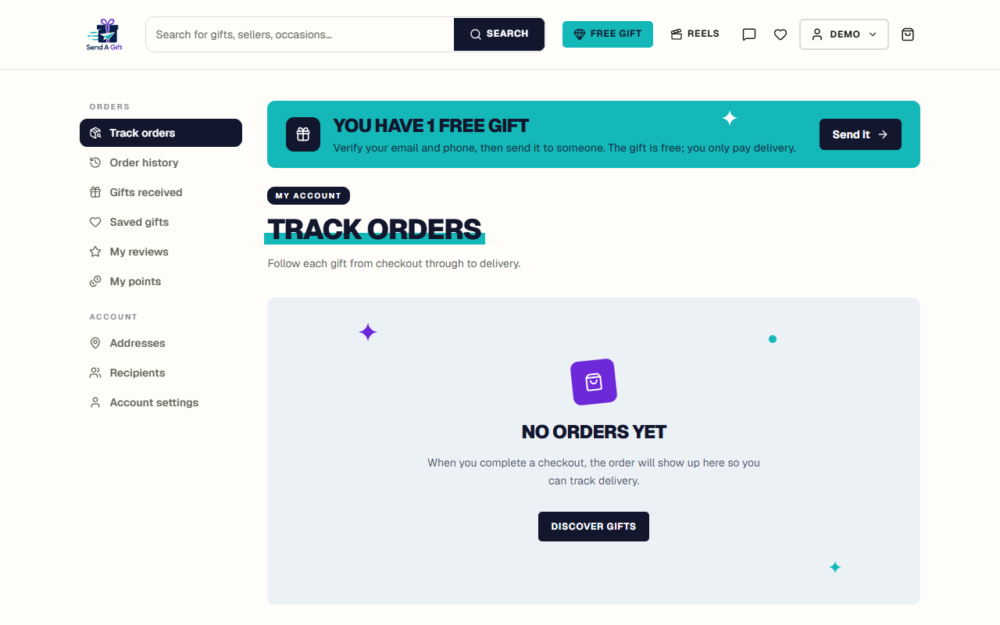


📸 **Screenshot needed:** `16-order-details.png`. One order opened, showing the progress timeline.

**Can I cancel?** Yes, until the seller has sent the gift out for delivery. After that, use the chat to contact the seller.

## 1.7 Leave a review

After a gift is delivered you can rate it from 1 to 5 stars, write a few words and add up to 9 photos or videos. One review per gift. Find it under **Order history**.


📸 **Screenshot needed:** `17-write-review.png`. The review form with stars, text box and photo upload.

## 1.8 Your account area

Everything personal lives under **My account**.

| Page | What it is for |
|---|---|
| **Profile** | Change your details, password or email, verify your phone, or delete your account. |
| **Addresses** | Your own delivery addresses. |
| **Recipients** | The people you send gifts to. |
| **Saved gifts** | Your wish list. |
| **Gifts received** | Gifts other people sent you. |
| **My reviews** | Reviews you wrote. You can edit or delete them. |
| **Points** | Your points balance and history. |

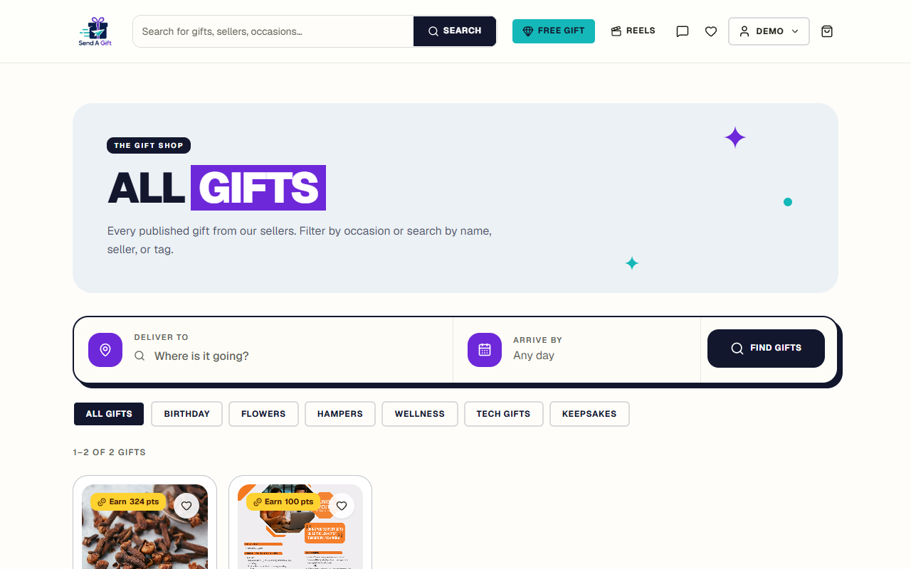

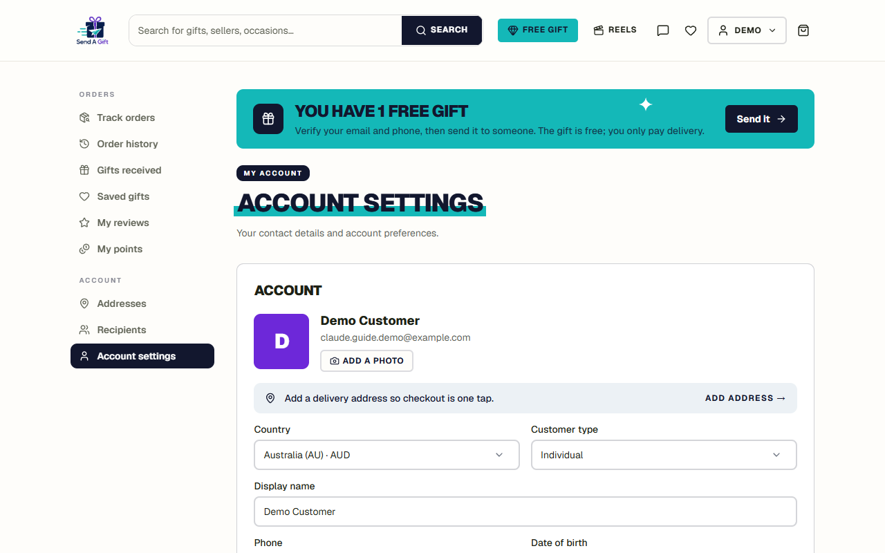

**Deleting your account:** go to **Profile → Delete account**. Your personal details are removed. You cannot do this while a gift is still on its way.

## 1.9 Your one free gift

Each customer can send **one free gift, once**. The seller pays for it, not you.

To use it you need:

- a **verified email** and a **verified phone number**;
- a recipient who has **both an email and a phone number**, and is **not yourself**.

Open the **Free gift** page, choose a gift, choose the recipient and confirm. The total is zero.

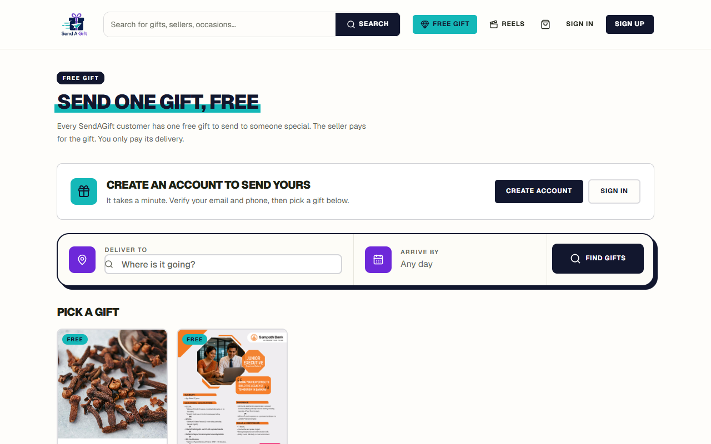

> This program is only available when the platform team has switched it on.

## 1.10 Points, games and competitions

- **Points** are a loyalty currency. You can earn them by playing games and by buying, and you can attach them to a gift as a bonus for the recipient.
- **Games** are simple skill games (like memory, snake or quiz). Play them to earn points. Scores are checked by the platform, so they cannot be faked.
- **Competitions** are time-limited contests with a live leaderboard. Winners can claim a prize.

> ℹ️ Games and competitions are not on the website's customer pages yet. Admins manage them (see Part 3), and they are built for the platform's other apps.

## 1.11 Reels

**Reels** are short vertical videos from sellers about their shops and gifts. You can watch, like and comment, even without an account.

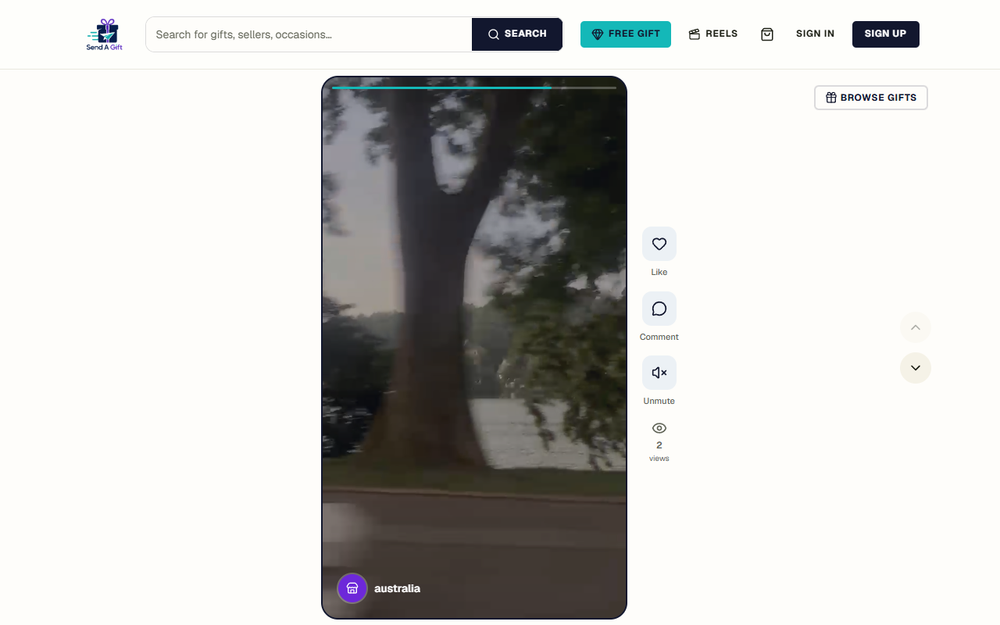

## 1.12 Chat with a seller

Click **Message** on a gift or shop page to ask a question. Replies appear in your inbox. You can send text and up to 5 files.


📸 **Screenshot needed:** `24-customer-chat.png`. A conversation between a customer and a seller.

---

# Part 2: For sellers (selling gifts)

## 2.1 Become a seller

Click **Become a seller** and complete the sign-up wizard. It takes a few steps:

| Step | What you provide |
|---|---|
| 1. **Business** | Your business name, whether it is registered, and tax details. |
| 2. **Your contact** | Your name, role, email and password. |
| 3. **Addresses** | Business, pickup and return addresses. |
| 4. **Your shop** | Shop name, web address name, category and gift options (message, wrapping, personalisation). |
| 5. **Delivery** | How far you deliver, what it costs and how long it takes. |
| 6. **Verification** | Confirm you are allowed to sell, accept the terms and the free gift budget. |
| 7. **Review and submit** | Check everything, then send. |

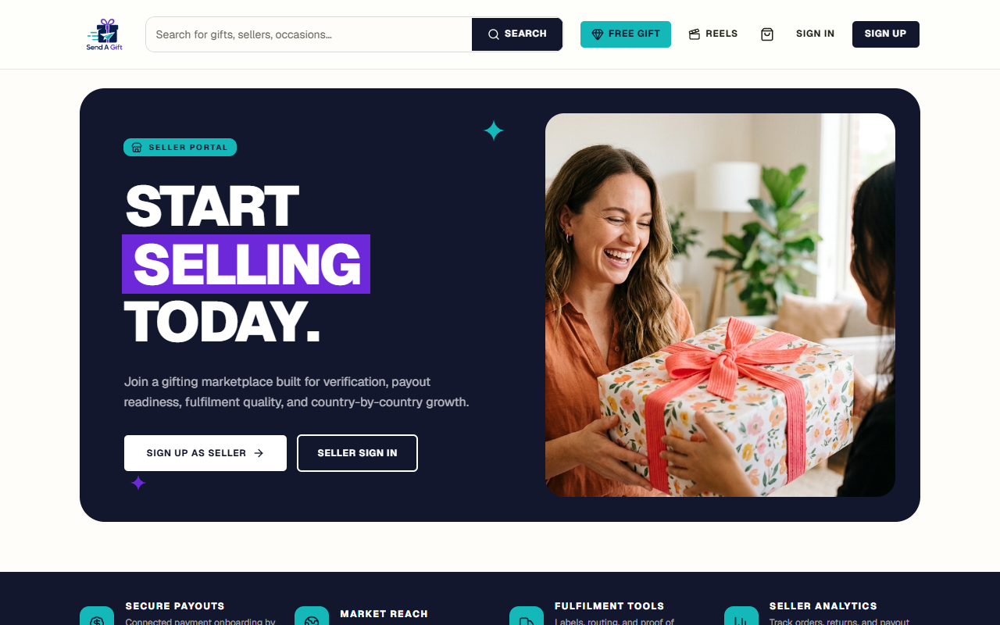

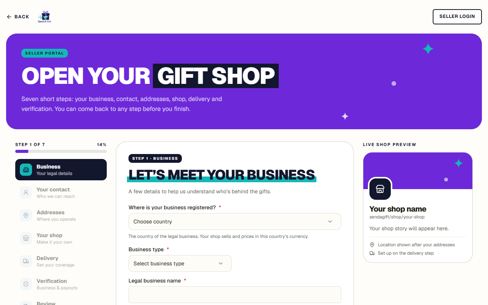

> ⚠️ Your shop needs a **pickup address chosen from the map search**. This is how the platform measures delivery distance.

### Confirm your email

Right after you submit, you get an email with a **6-digit code**. Type it on the confirmation page.

- The code works for **15 minutes**.
- You get **5 tries**.
- You can ask for a new code once per **minute**.

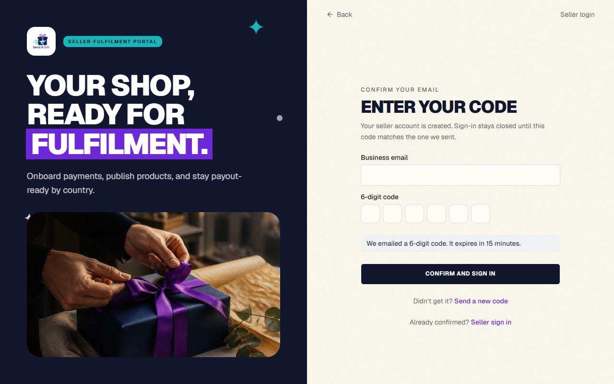

Then sign in on the **Seller sign in** page.

### Verified badge

The platform team may review you and give you a **Verified seller** badge, which customers can see on your shop. If a seller is **suspended**, they can no longer use the seller area.

## 2.2 Your seller workspace

After signing in you will see a menu on the side:

| Menu item | What it is for |
|---|---|
| **Dashboard** | A quick summary and shortcuts. |
| **Shops** | Create and edit shops and set delivery areas. |
| **Products** | Add and edit gifts. |
| **Inventory** | Stock levels and days you cannot deliver. |
| **Reels** | Short promo videos. |
| **Orders** | Accept and deliver orders. |
| **Reviews** | Read and reply to reviews. |
| **Earnings** | See what you have earned. |
| **Payouts** | Connect your bank through Stripe and withdraw money. |
| **Points** | Buy points to reward customers. |
| **Free gifts** | Join the free gift program. |
| **Analytics** | Charts about how you are doing. |
| **Inbox** | Chat with customers. |
| **Profile** | Your business details, password and email. |

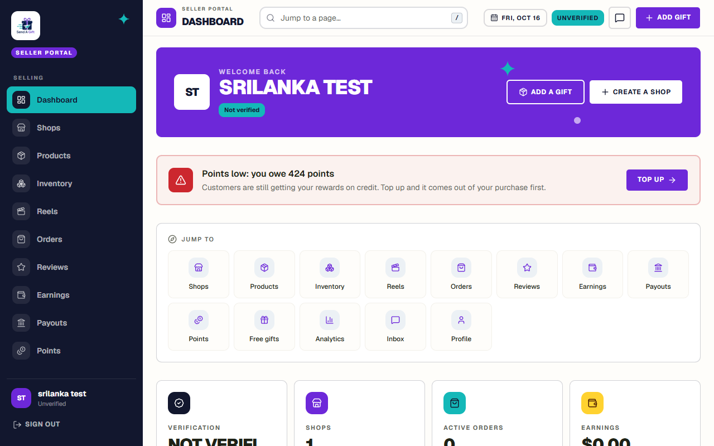

## 2.3 Set up your shop and delivery areas

Your **delivery range** decides **who can order from you** and **what delivery costs**. Each range is a distance band around your shop with its own price. The map draws the bands as blue circles. The closest band that covers the recipient sets the delivery price at checkout. A band can be **Same day**, which needs a daily **cutoff time** (orders after it arrive the next day).

Example:

| Up to (km) | Price | Delivery time |
|---|---|---|
| 5 km | $5 | Same day (cutoff 2:00 PM) |
| 15 km | $9 | 2 days |
| 30 km | $15 | 3 days |

To change it, open **Shops**, click edit on your shop and go to the **Delivery range** step.

Without a pickup address and at least one range, customers cannot find you.

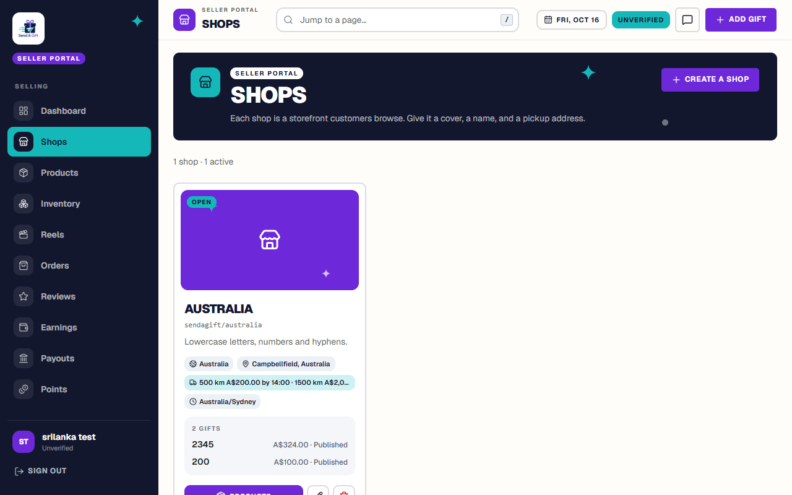

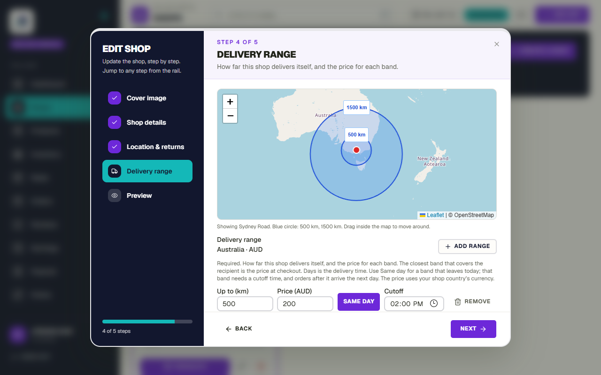

You can run **more than one shop**, each with its own address and zones.

## 2.4 Add a gift (product)

Adding a product is a six-step wizard:

1. **The gift:** name, description, occasion, and whether it is for personal buyers, businesses or both.
2. **Price:** the price and currency, and optional reward points.
3. **Photos and videos:** up to 12. The first image becomes the cover.
4. **Stock:** how many you have, a low-stock warning level, and **days you cannot deliver**.
5. **Parcel:** length, width, height and weight.
6. **Preview**, then save as a **draft** or **publish**.

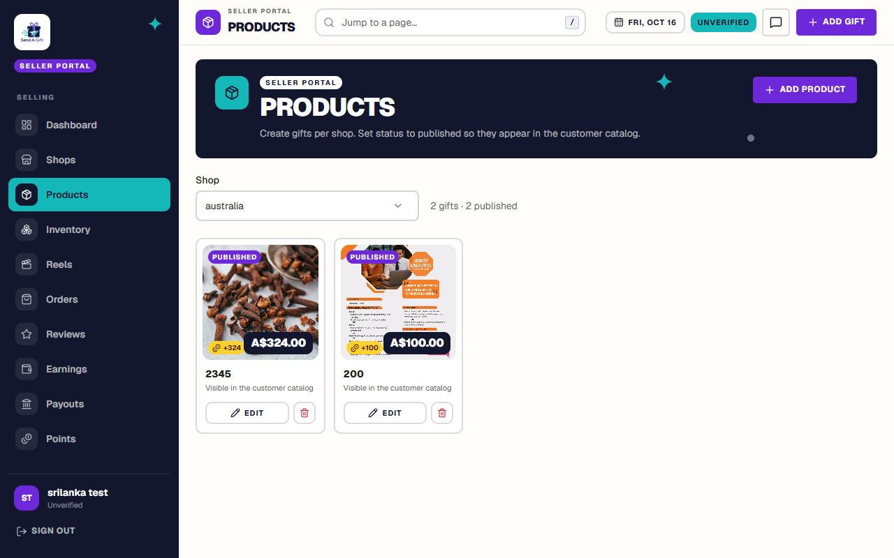

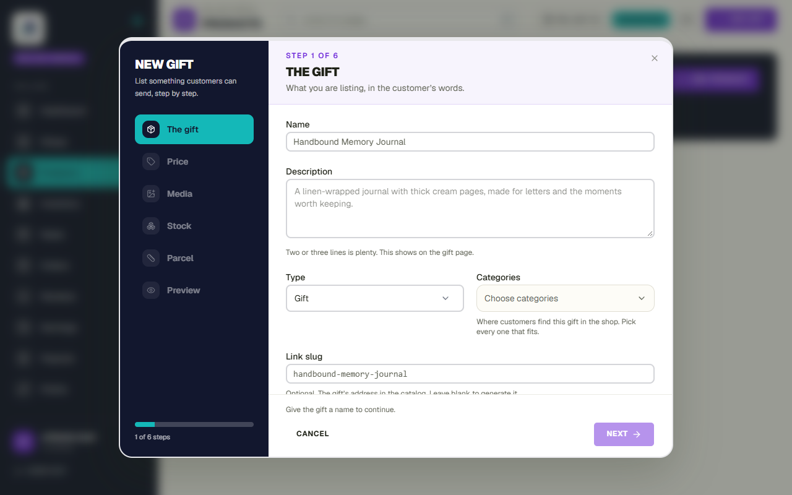

| Product status | Meaning |
|---|---|
| **Draft** | Saved but not visible to customers. |
| **Published** | Live in the shop. |
| **Paused** | Hidden for now. Use this to hide a gift without deleting it. |
| **Rejected** | Not allowed by the platform. |

**Inventory tip:** on the Inventory page, the **Needs attention** filter shows what is out of stock or running low.

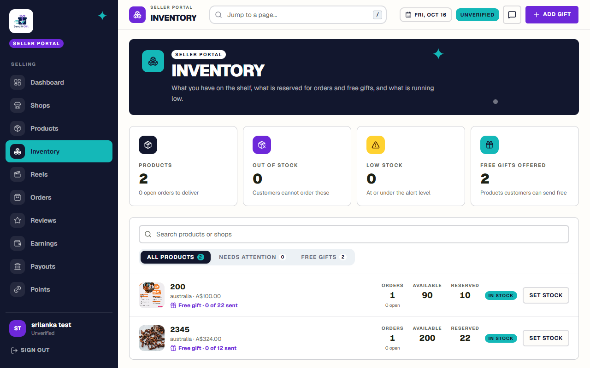

## 2.5 Handle an order

When a customer pays, a new order appears under **Orders**.

```
New order  ─▶  Accept  ─▶  Prepare the gift  ─▶  Start delivery  ─▶  Mark delivered
 (pending)    (accepted)                        (on the way)         (delivered)
```

1. Open **Orders** and click the new order to see the product, recipient, address, date and what the customer paid for delivery.
2. Click **Accept**.
3. Prepare the gift.
4. Click **Start delivery** and enter your courier or tracking details. The customer can now see tracking.
5. When it arrives, click **Mark delivered**.

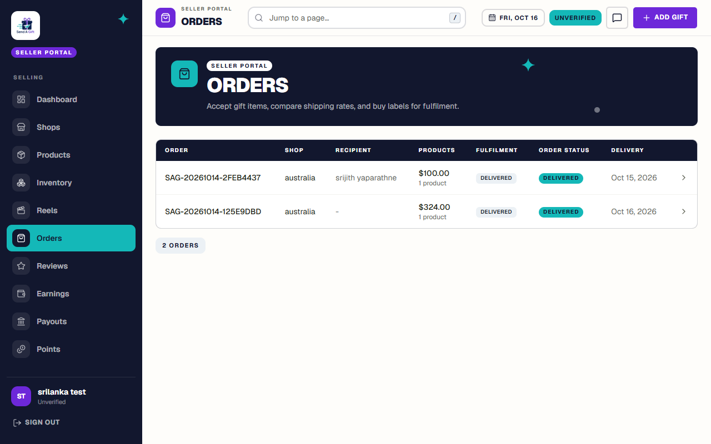

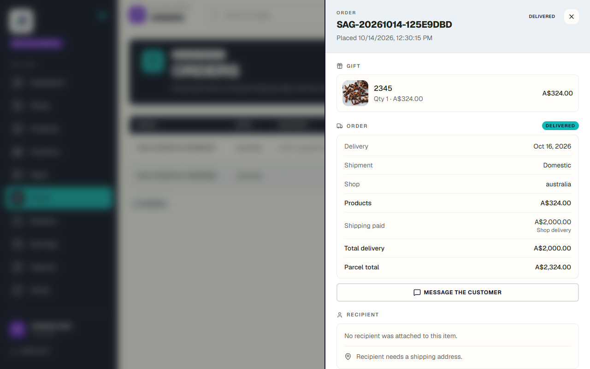


📸 **Screenshot needed:** `41-start-delivery.png`. The dialog where courier or tracking details are entered.

> If a customer orders from several sellers at once, each seller only sees and handles **their own items**.

## 2.6 Reviews, reels and chat

- **Reviews:** read what customers say and **reply**. Unanswered reviews are counted for you.
- **Reels:** a 5-step wizard (clip, caption, tagged gift, publishing, preview) for short promo videos.
- **Inbox:** answer customer questions. The menu shows how many messages are unread.

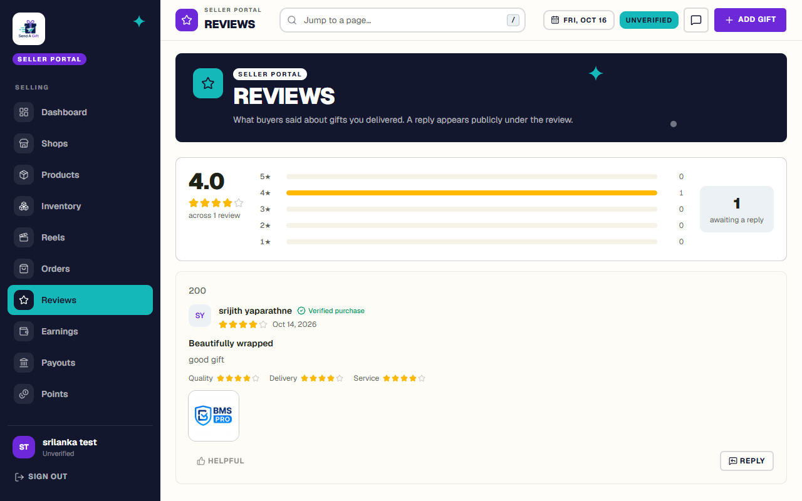

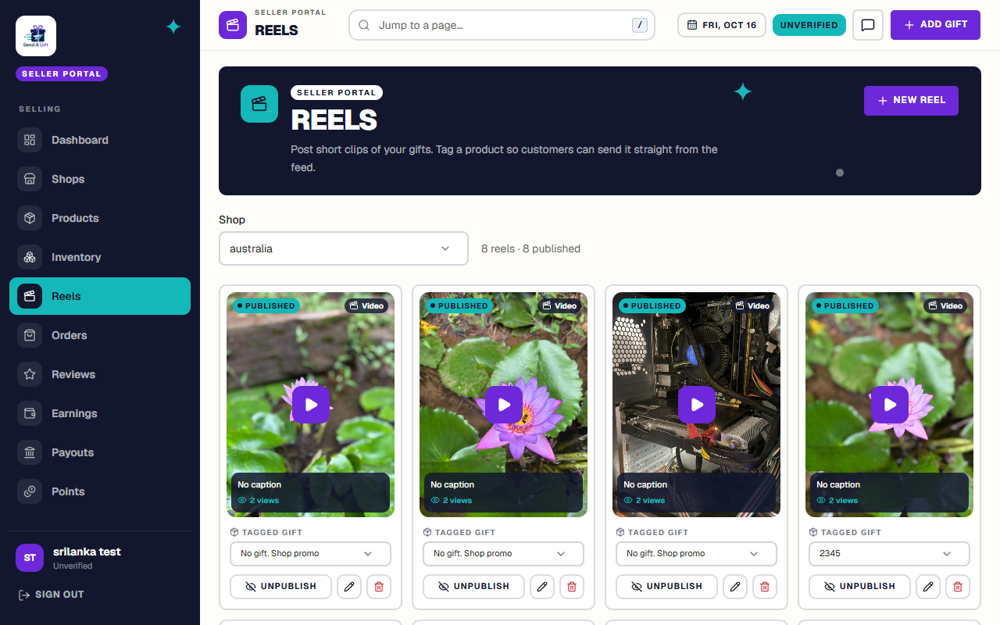

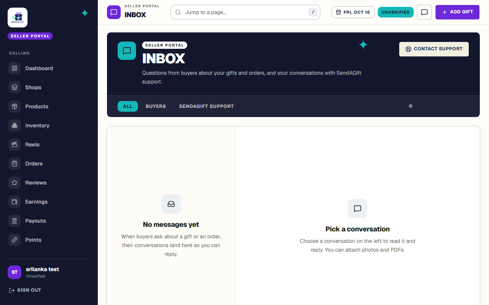

## 2.7 Getting paid

1. Open **Payouts**.
2. Connect your **Stripe** account (a short online form).
3. Choose to withdraw yourself or get paid automatically.
4. See your payout history on the same page.

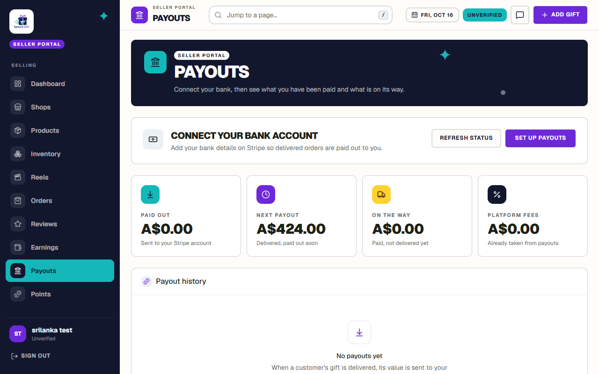

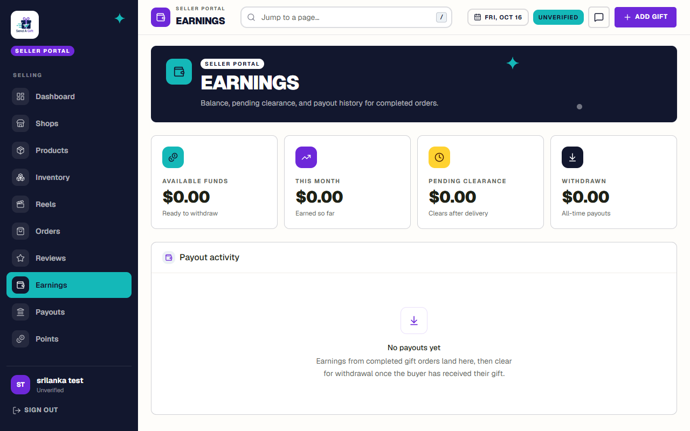

## 2.8 Points and the free gift program

- **Points:** buy a points package. Points are used to reward customers who buy your products. You will see a warning when your points are running low.
- **Free gifts:** you set a budget and choose which products customers may send for free. You pay for those gifts and their delivery from that budget. This is a good way to get new customers.

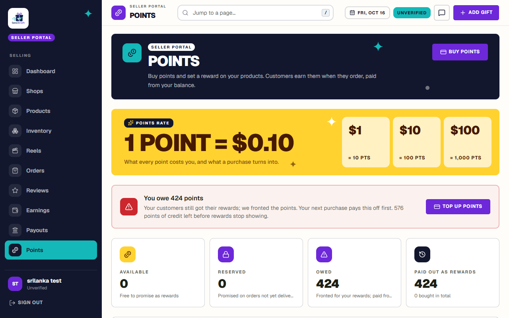

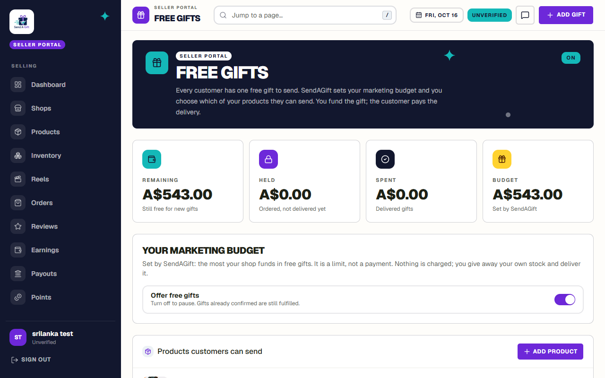

## 2.9 Your account

Under **Profile** you can change your business details, addresses, password and email. Changing an email needs a code, and the old address gets a "this wasn't me" link to undo it. You can also close your account there.

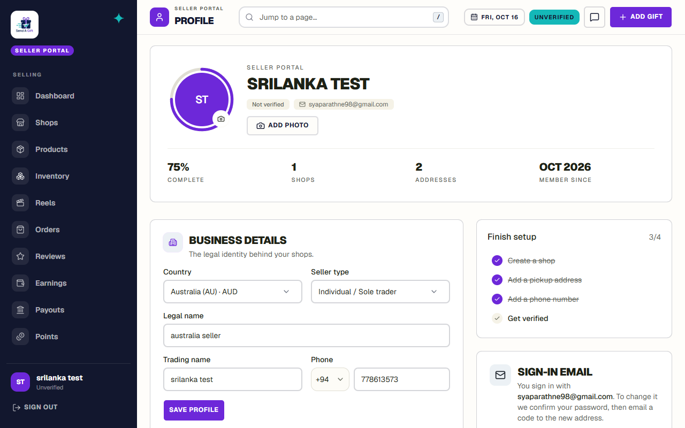

---

# Part 3: For admins (running the platform)

Admins sign in on the **Admin sign in** page. There are two levels:

- **Admin:** day-to-day running (sellers, customers, support, countries).
- **Superadmin:** can do everything an admin can, plus the sensitive actions marked 🔒 below.

> 🔒 **Extra safety:** for sensitive actions (like confirming a payment or adjusting points) the app asks you to **type your password again**. It then stays valid for 5 minutes.


📸 **Screenshot needed:** `60-admin-reauth.png`. The "confirm your password" pop-up.

## 3.1 First-time setup

The very first superadmin is created once, by the technical team, using a secret key. After that, this step cannot be repeated. Ask your technical contact if you do not have an admin account yet.


## 3.2 Admin workspace

| Group | Page | What it is for |
|---|---|---|
| Overview | **Dashboard** | What needs attention today. |
| Support | **Inbox** | Messages from customers and sellers. |
| Marketplace | **Sellers** | Review, verify or suspend sellers. |
| Marketplace | **Customers** | Look up customers, see orders, adjust points. |
| Marketplace | **Seller points** | Approve or reject sellers' points purchases. |
| Marketplace | **Point packages** | The bundles sellers can buy. |
| Marketplace | **Free gifts** | Watch and control the free gift program. |
| Games | **Games & scores** | See scores and spot cheating. |
| Games | **Competitions** | Create and run contests. |
| Configuration | **Countries** | Decide where the platform is open. |
| Account | **Profile** | Your name and photo. |


📸 **Screenshot needed:** `62-admin-dashboard.png`. The admin dashboard with the side menu.

## 3.3 Countries (do this first)

Every account belongs to a country. Each country has **on/off switches** that control what is allowed there, such as:

- customers can sign up
- sellers can sign up
- sellers can receive payouts
- delivery inside the country, and across borders
- points can be earned and spent
- skill competitions are allowed

If a switch is off, people in that country see a message such as *"Registration is disabled for this country"*.

**To change a country:** open **Countries**, pick a country and flip the switches.


📸 **Screenshot needed:** `63-admin-countries.png`. The Countries list.


📸 **Screenshot needed:** `64-country-switches.png`. A single country with its on/off switches.

## 3.4 Sellers

Use the tabs **Active · Suspended · All** and the search box (name or email) to find a seller. Open a seller to see their business details, addresses and shops.

| Action | What it does |
|---|---|
| **Verify** | Gives the seller the "Verified seller" badge. |
| **Suspend** | Stops the seller from using the platform. Undo it any time with **Reactivate**. |


📸 **Screenshot needed:** `65-admin-sellers.png`. The Sellers page with tabs and search.


📸 **Screenshot needed:** `66-admin-seller-detail.png`. One seller opened, showing the Verify and Suspend options.

## 3.5 Customers

Search by name or email. Open a customer to see their profile, orders and points. You can add or remove points with a written reason, for example as a goodwill gesture 🔒.


📸 **Screenshot needed:** `67-admin-customer-detail.png`. One customer opened, showing orders and points.

## 3.6 Seller points and point packages

- **Seller points:** shows every points purchase with tabs **Pending · Completed · Failed · Cancelled · All**. A superadmin can confirm or reject a purchase 🔒.
- **Point packages:** the bundles of points sellers can buy. A superadmin creates and edits them 🔒.
- **Earning rules:** set per country how customers earn points 🔒.


📸 **Screenshot needed:** `68-admin-points.png`. The Seller points page.

## 3.7 Free gifts

See each seller's free gift program and the orders sent. You can **stop or resume** a seller's program and set the **budget per country**.


📸 **Screenshot needed:** `69-admin-free-gifts.png`. The admin Free gifts page.

## 3.8 Games and competitions

- **Games:** view leaderboards, review suspicious scores, and set how many points a game costs to play 🔒.
- **Competitions:** each one moves through these stages:

```
Draft ─▶ Scheduled ─▶ Live ─▶ Closed ─▶ Finalised (winners fixed)
                       │  ▲
                    Pause  Resume
```

A superadmin schedules, pauses, closes and finalises competitions and funds the prize pool. Cancelling and prize changes need password confirmation 🔒.


📸 **Screenshot needed:** `70-admin-games.png`. The Games page.


📸 **Screenshot needed:** `71-admin-competitions.png`. The Competitions list with status tabs.

## 3.9 Support inbox

The Inbox works like the chat customers and sellers use. Open a conversation, reply, and **close** it when finished. You can reopen it later.


📸 **Screenshot needed:** `72-admin-inbox.png`. The admin Inbox with a conversation open.

---

# Part 4: For people who receive a gift

If someone sends you a gift, you do **not** need an account to receive it.

1. You get an **email and a text message** when it is sent, and again when it arrives.
2. After delivery, the message contains a **review link**.
3. Open the link and choose the **one-time code** option.
4. A **6-digit code** is sent to the email or phone the link was sent to. Type it in.
5. You are signed in (an account is created for you if you did not have one).
6. Open **Gifts received** to say thank you with a review.


📸 **Screenshot needed:** `80-recipient-email.png`. An example of the email or text a recipient receives.


📸 **Screenshot needed:** `81-recipient-code.png`. The page where the 6-digit code is typed.

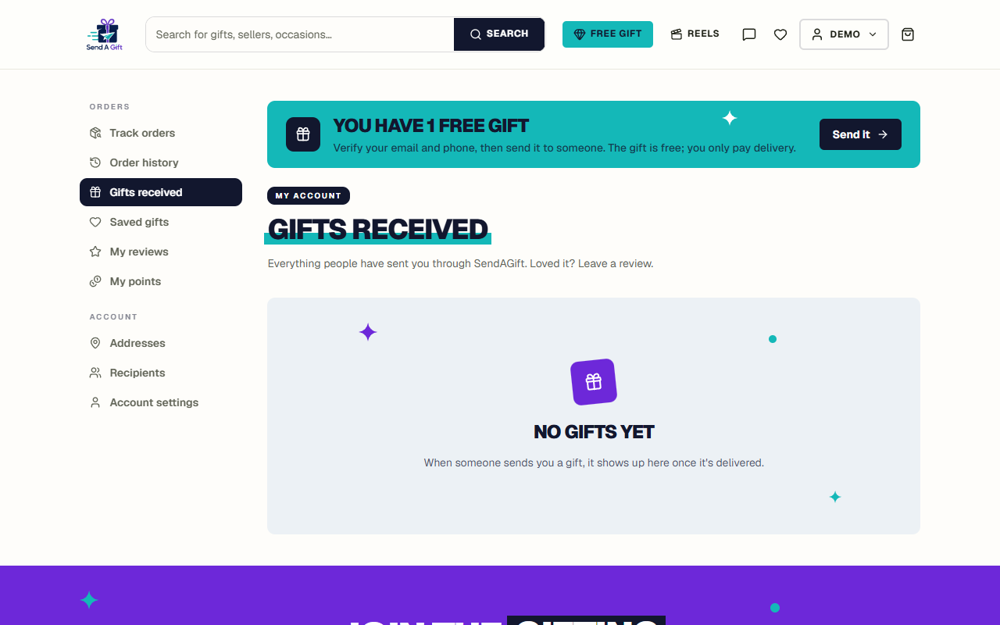

---

## What the order statuses mean

| Status | In plain words |
|---|---|
| **Awaiting payment** | The order exists but is not paid yet. |
| **Paid** | Payment went through. Waiting for the seller. |
| **Accepted** | The seller agreed to make the delivery. |
| **Preparing** | The seller is getting the gift ready. |
| **On the way** | The gift has left the seller. |
| **Delivered** | The gift arrived. |
| **Cancelled** | The order was stopped. |
| **Refunded** | The money was returned. |

An order with gifts from several sellers is only **Delivered** when **every** gift has been delivered or cancelled.

---

## Common questions

**Do I need an account to look around?**
No. You can browse, search, watch reels and play games without one. You need an account to save gifts, buy and review.

**Can I buy from more than one seller at once?**
Yes. Each seller delivers their own gift.

**Does the person receiving the gift need an account?**
No. They are told by email and text. They only sign in if they want to leave a review.

**Who pays for delivery?**
The customer, at checkout. The price depends on the shop's delivery zones. Free gifts are paid by the seller.

**How is my card handled?**
Securely through Stripe. Sellers get paid into their own Stripe account.

**Can I change the address after ordering?**
The order keeps the address it was placed with. Message the seller in chat to ask for a change.

**Can I use one email as both a customer and a seller?**
No. Customer and seller accounts are separate, so use a different email for each.

**What does "Verified seller" mean?**
The platform team has checked this seller.

---

## If something goes wrong

| What you see | What it means and what to do |
|---|---|
| *Registration is disabled for this country* | Sign-up is not open in that country yet. Pick another country or contact support. |
| *Email already registered* | You already have an account. Sign in, or use **Forgot password**. |
| *Password needs at least 8 characters* | Make your password longer. |
| *Confirm your email before signing in* (sellers) | Type the 6-digit code from your email. |
| *That code has expired* | Ask for a new code. |
| *Too many tries* | Ask for a new code. |
| *Wait a minute before asking for another code* | Wait 60 seconds, then try again. |
| *Invalid email or password* | Check both, or use **Forgot password**. For safety it does not say which one is wrong. |
| Gift search shows **0 gifts** | No shop delivers there on that date. Try another date or address. |
| *Delivery date must be today or later* | Pick today or a future date. |
| *Not enough points* | Use fewer points, or earn more first. |
| *Order cannot be cancelled* | It has already been sent. Message the seller. |
| *You have a gift on its way* (deleting account) | Wait until it is delivered or cancelled, then try again. |
| *Order item cannot be accepted* (seller) | It was already accepted or cancelled. Refresh the page. |
| *Shop needs a pickup address* (seller) | Add a pickup address by choosing it from the map search. |
| *Too many requests* | You tried too fast. Wait a minute. |
| Seller area says *suspended* | The platform team paused the account. Contact support. |

**Still stuck?** Use the in-app chat to reach support.

---

## Words explained

| Word | Meaning |
|---|---|
| **Recipient** | The person receiving the gift. |
| **Seller** | A business or person who sells gifts. |
| **Shop** | A seller's storefront. One seller can have several. |
| **Delivery zone** | A distance around a shop with its own delivery price and time. |
| **Reel** | A short vertical video from a seller. |
| **Points** | A loyalty currency that can be earned, spent and gifted. |
| **Free gift** | A one-time gift paid for by the seller's marketing budget. |
| **One-time code** | A 6-digit code sent to your phone or email to prove it is you. |
| **Stripe** | The secure service that handles card payments and seller payouts. |
| **Verified seller** | A seller the platform team has checked. |
| **Suspended** | An account that has been paused by the platform team. |
| **Superadmin** | The most trusted admin level. |
| **Competition** | A time-limited contest with a prize. |

---

## Screenshot checklist

Tick each one off as you add it to `docs/screenshots/`.

**General**
- [x] 01-home-page.png

**Customer**
- [x] 03-gifts-page.png
- [x] 04-where-and-when.png
- [x] 05-gift-page.png
- [x] 06-register.png
- [x] 07-sign-in-options.png
- [x] 08-recipients.png
- [x] 09-add-recipient.png
- [x] 10-cart.png
- [x] 11-checkout-recipient.png
- [x] 12-checkout-date-delivery.png
- [x] 13-checkout-message-payment.png
- [ ] 14-order-confirmation.png
- [x] 15-track-orders.png
- [ ] 16-order-details.png
- [ ] 17-write-review.png
- [x] 18-account-menu.png
- [x] 19-profile.png
- [x] 20-free-gift.png
- [x] 23-reels.png
- [ ] 24-customer-chat.png

**Seller**
- [x] 30-become-a-seller.png
- [x] 31-seller-wizard.png
- [x] 32-seller-verify-email.png
- [x] 33-seller-dashboard.png
- [x] 34-seller-shops.png
- [x] 35-delivery-zones.png
- [x] 36-seller-products.png
- [x] 37-product-wizard.png
- [x] 38-inventory.png
- [x] 39-seller-orders.png
- [x] 40-seller-order-detail.png
- [ ] 41-start-delivery.png
- [x] 42-seller-reviews.png
- [x] 43-seller-reel.png
- [x] 44-seller-inbox.png
- [x] 45-payouts.png
- [x] 46-earnings.png
- [x] 47-seller-points.png
- [x] 48-seller-free-gifts.png
- [x] 49-seller-profile.png

**Admin**
- [ ] 60-admin-reauth.png
- [x] 61-admin-login.png
- [ ] 62-admin-dashboard.png
- [ ] 63-admin-countries.png
- [ ] 64-country-switches.png
- [ ] 65-admin-sellers.png
- [ ] 66-admin-seller-detail.png
- [ ] 67-admin-customer-detail.png
- [ ] 68-admin-points.png
- [ ] 69-admin-free-gifts.png
- [ ] 70-admin-games.png
- [ ] 71-admin-competitions.png
- [ ] 72-admin-inbox.png

**Recipient**
- [ ] 80-recipient-email.png
- [ ] 81-recipient-code.png
- [x] 82-gifts-received.png

> **Screenshot tips:** use a clean demo account with realistic sample data, hide any real emails or phone numbers, and capture at the same browser width each time (about 1280 px wide) so the pictures look consistent.

